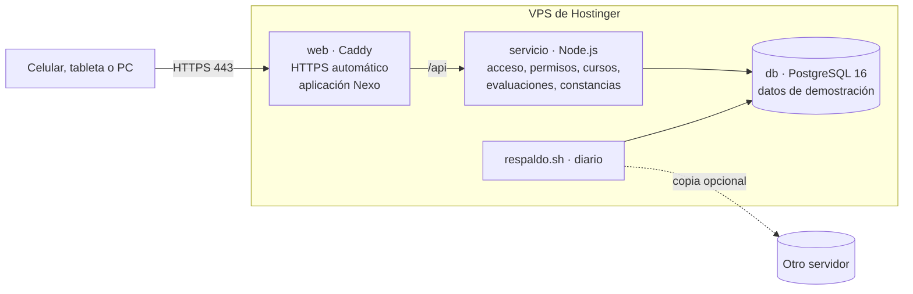

# Guía de instalación en Hostinger (VPS)

**Para:** Departamento de Capacitación (responsable) y TI (aprobación pendiente, D-33).
**Resultado:** Nexo funcionando en un subdominio con HTTPS. Las personas entran con su número y frase, toman cursos, presentan evaluaciones, validan prácticas y descargan constancias. Todo se guarda en la base, con los **datos de demostración ficticios** cargados.

Etiquetas: **[H]** hecho confirmado · **[R]** recomendación · **[S]** supuesto · **[P]** pendiente.

> **Ambiente de demostración con datos ficticios.** La aplicación funciona de punta a punta: lo que cada persona hace en la página se guarda en la base y queda en la bitácora.
>
> Antes de cargar datos reales de personas faltan:
> - La aprobación de TI.
> - La ubicación de los datos (D-64).
> - La revisión de seguridad independiente.
> - La Etapa 5.

## Contenido

1. [Qué se instala](#1-qué-se-instala)
2. [Qué contratar en Hostinger](#2-qué-contratar-en-hostinger)
3. [Preparar el VPS](#3-preparar-el-vps)
4. [Apuntar el subdominio](#4-apuntar-el-subdominio)
5. [Subir Nexo al VPS](#5-subir-nexo-al-vps)
6. [Instalar y cargar los datos de demostración](#6-instalar-y-cargar-los-datos-de-demostración)
7. [Comprobar que todo funciona](#7-comprobar-que-todo-funciona)
8. [Respaldos](#8-respaldos)
9. [Operación diaria](#9-operación-diaria)
10. [Alternativa: solo la página del prototipo en el hospedaje web](#10-alternativa-solo-la-página-del-prototipo-en-el-hospedaje-web)
11. [Qué se probó y qué no](#11-qué-se-probó-y-qué-no)

---

## 1. Qué se instala



| Contenedor | Qué hace | Puertos abiertos a internet |
|---|---|---|
| `web` (Caddy 2.8.4) | Obtiene y renueva el certificado HTTPS, sirve la aplicación (`app/web`) con política de seguridad de contenido y pasa `/api` al servicio | 80 y 443 |
| `servicio` (Node.js 22) | Acceso y sesiones, permisos por rol y alcance, lecciones, evaluaciones calificadas en el servidor, validación práctica, reglas, excepciones, constancias, exportaciones y proceso diario de renovaciones | Ninguno |
| `db` (PostgreSQL 16.6) | Base con aislamiento por empresa, bitácora y reglas protegidas | Ninguno |

**Por qué un VPS:**
- **[H]** El hospedaje web compartido de Hostinger no admite PostgreSQL. Para PostgreSQL y un servicio Node.js permanente se necesita un VPS.
- **[R]** Docker Compose deja todo en un solo servidor, con las mismas imágenes que se probaron. Si después TI decide mudarse a otro proveedor, se lleva igual.

Fuentes: [soporte de Hostinger sobre PostgreSQL](https://support.hostinger.com/en/articles/1583659-is-postgresql-supported-at-hostinger) y [planes VPS](https://www.hostinger.com/vps-hosting).

## 2. Qué contratar en Hostinger

| Concepto | Recomendación | Estado |
|---|---|---|
| Plan | **VPS KVM** con al menos **2 vCPU y 8 GB de RAM**. En el catálogo consultado corresponde a KVM 2; verifica nombre y precio vigentes al contratar | **[S]** Tamaño estimado para 400 sesiones simultáneas; se confirma con la prueba de carga de la Etapa 5 (D-35) |
| Sistema | Plantilla **Ubuntu 24.04 con Docker** si aparece en hPanel; si no, Ubuntu 24.04 y se instala Docker (paso 3) | [R] |
| Ubicación del centro de datos | La que decidan TI y jurídico para datos personales de trabajadores | **[P] D-64.** Mientras solo haya datos ficticios no bloquea |
| Respaldos de Hostinger | Respaldo semanal incluido; respaldo **diario** como complemento de pago | **[P] D-65.** Se recomienda el diario más el script propio (sección 8) |
| Dominio | Un **subdominio** de un dominio de la empresa, por ejemplo `capacitacion.dominio-de-la-empresa.com` | [P] lo elige la empresa |
| Almacenamiento de archivos | Hostinger no ofrece almacenamiento de objetos tipo S3 en lo consultado. Para las evidencias y los PDF (módulos M7 y M8) se usará el disco del VPS con respaldo | [R] revisar en M7 |

Fuente sobre respaldos: [respaldo y restauración de un VPS](https://www.hostinger.com/support/1583232-how-to-back-up-or-restore-a-vps).

**Costos:** no se incluyen montos. El plan, el complemento de respaldo diario y el dominio se cotizan en hPanel al contratar.

## 3. Preparar el VPS

Hazlo en hPanel → **VPS**.

1. **Llave SSH.** En «Configuración → Llaves SSH», agrega la llave pública de quien administrará el servidor. Evita entrar con contraseña.
2. **Firewall.** En «Seguridad → Firewall», crea una regla que permita solo:
   - 22 (SSH), de preferencia solo desde la IP de la oficina.
   - 80 y 443 (web).
3. **Entra por SSH** con la IP que muestra hPanel:

```bash
ssh root@IP_DEL_VPS
```

4. **Actualiza el sistema e instala lo necesario.** Si elegiste la plantilla con Docker, `docker compose version` ya responde y puedes omitir la instalación de Docker.

```bash
apt-get update && apt-get -y upgrade && apt-get install -y git curl python3 openssl
```

```bash
curl -fsSL https://get.docker.com | sh
```

5. **Crea un usuario de operación** para no trabajar como `root`:

```bash
adduser nexo && usermod -aG docker nexo
```

Copia tu llave SSH a ese usuario y desde aquí trabaja como `nexo`:

```bash
rsync --archive --chown=nexo:nexo ~/.ssh /home/nexo
```

> **Nota de seguridad [R]:** pertenecer al grupo `docker` equivale a ser administrador del servidor. Solo deben tenerlo las personas que operen Nexo. TI debe definir quién (D-62).

## 4. Apuntar el subdominio

En hPanel → **Dominios → DNS** del dominio de la empresa, agrega:

| Tipo | Nombre | Apunta a | TTL |
|---|---|---|---|
| A | `capacitacion` (o el que elijan) | IP del VPS | 3600 |

Si el dominio no está en Hostinger, se agrega el mismo registro donde se administre su DNS. Espera a que el subdominio responda con la IP del VPS antes del paso 6; el certificado HTTPS se obtiene automáticamente solo cuando el DNS ya apunta al servidor.

```bash
getent hosts capacitacion.dominio-de-la-empresa.com
```

## 5. Subir Nexo al VPS

Como usuario `nexo`. Elige **una** de estas dos formas.

**A. Con git (recomendada).** El repositorio es privado: crea en GitHub una «deploy key» de solo lectura con una llave SSH del VPS y clona:

```bash
sudo mkdir -p /opt/nexo && sudo chown nexo:nexo /opt/nexo
```

```bash
git clone --branch claude/friendly-cori-l43oy7 git@github.com:avlv0119-ai/Capacitacion.git /opt/nexo
```

**B. Sin git.** Descarga el repositorio como `.zip` desde GitHub y súbelo con el Administrador de archivos de hPanel o con `scp`. Descomprímelo en `/opt/nexo`.

## 6. Instalar y cargar los datos de demostración

Todo se ejecuta dentro de `/opt/nexo/despliegue/hostinger`:

```bash
cd /opt/nexo/despliegue/hostinger
```

**6.1 Crear los secretos.** Genera el archivo `.env` con contraseñas y secretos aleatorios (permisos 600). Cambia el subdominio por el real:

```bash
./scripts/secretos.sh capacitacion.dominio-de-la-empresa.com
```

> Guarda una copia de `.env` en el gestor de contraseñas del Departamento de Capacitación o de TI. No se sube al repositorio (`.gitignore` lo excluye).

**6.2 Construir y arrancar** (la primera vez tarda unos minutos):

```bash
docker compose up -d --build
```

```bash
docker compose ps
```

Los tres contenedores deben estar `Up`; `db` y `servicio`, además, `(healthy)`.

**6.3 Crear la base** (aplica las migraciones y el usuario limitado del servicio; se puede repetir sin riesgo):

```bash
./scripts/migrar.sh
```

**6.4 Cargar los datos de demostración** (solo funciona con la base vacía, para no mezclarlos con datos reales):

```bash
./scripts/cargar_demo.sh
```

Al final muestra **una sola vez** las 7 cuentas de demostración con su frase de acceso generada al azar:

| Número | Rol | Qué debe ver |
|---|---|---|
| 000215 | Administrador | Toda la empresa |
| 000412 | Recursos Humanos | Toda la empresa |
| 001920 | Supervisora y validadora | Solo su equipo (Ensamble · Turno 2) y lo suyo |
| 001377 | Instructora | Sus cursos y lo suyo como trabajadora |
| 000533 | Auditor (solo lectura) | Toda la empresa, sin modificar |
| 004817 | Trabajadora | Solo lo suyo |
| C-000123 | Contratista | Solo lo suyo |

Anota las frases en el gestor de contraseñas. Si se pierden, se generan otras con `./scripts/frases_demo.sh` (sección 9).

**Qué contiene la demostración [H]:**
- 116 personas ficticias, 346 asignaciones, 365 participaciones, 319 intentos, 31 validaciones prácticas, 243 acreditaciones, 243 constancias y unas 2,200 entradas de bitácora.
- 5 cursos con lecciones jugables y evaluación.
- Puntos de la semana para el ranking del equipo.

Las fechas se ajustan al día de la carga. Todo es ficticio y está marcado como DEMO; el contenido de los cursos es de ejemplo y no son procedimientos de la empresa.

## 7. Comprobar que todo funciona

```bash
./scripts/verificar.sh
```

Revisa los contenedores, la página por HTTPS, el servicio, la base, el bloqueo a buscadores y la redirección de HTTP a HTTPS. Para probar además una cuenta (pide la frase sin mostrarla):

```bash
./scripts/verificar.sh 001920
```

Debe terminar con «Todo correcto».

### 7.1 Recorrido sugerido para mostrar Nexo

Abre `https://capacitacion.dominio-de-la-empresa.com` en una PC y en un celular. Después de la animación de entrada aparece la pantalla de acceso. La primera vez que cada persona entra, una bienvenida de tres pasos le explica la pantalla.

| Paso | Quién | Qué hacer |
|---|---|---|
| 1. Asignar | Ana Ruiz (000412, RH) | Reglas de asignación → Nueva regla → «Orden y limpieza del área» → Ensamble → revisa la vista previa → Crear |
| 2. Aprender | Rosa Elena Ibarra (004817), de preferencia en un celular | Mis cursos → «Orden y limpieza del área» → completa las 4 lecciones (prueba equivocarte para ver la explicación) |
| 3. Evaluar | Rosa | Presenta la evaluación. La califica el servidor |
| 4. Validar | Laura Peña (001920, supervisora) | Validación práctica → marca los criterios → confirma con su frase → Registrar. El curso queda acreditado y la constancia se emite con folio |
| 5. Constancia | Rosa | Confirma su práctica en Inicio → abre la constancia → Descargar PDF |
| 6. Consultar | Ana o Carlos Mora (000215, Administrador) | Tablero (toca un indicador), Matriz, Reportes (exporta a Excel o PDF) y Bitácora: cada paso del recorrido quedó registrado |

**Otras cosas que puedes probar:**
- **Activar una cuenta nueva.** Como Carlos: Personas → elige a alguien con cuenta «Sin activar» → Acceso → Generar ficha de activación. Luego, en otra ventana, «¿Es tu primera vez?» con ese número y código.
- **Excepciones.** Como Ana: en la ficha de una persona con un curso atrasado o con intentos agotados.
- **Ranking privado.** Como Rosa: Logros → apaga «Mostrarme en el ranking».
- **Buscador.** En la consola, Ctrl + K.
- **Cierre por inactividad.** En un equipo compartido, deja la sesión 5 minutos sin usar.

**Si algo falla:**

| Síntoma | Causa probable | Qué hacer |
|---|---|---|
| La página no carga o el navegador advierte del certificado | El DNS aún no apunta al VPS o el firewall bloquea 80/443 | Revisa el paso 4 y el firewall; luego `docker compose restart web` |
| «El servicio o la base no responden» | El servicio no conecta con la base | Revisa `docker compose logs servicio` y vuelve a correr `./scripts/migrar.sh` |
| `cargar_demo.sh` dice que la base ya tiene personas | Ya se cargó antes | No hace falta repetirlo |

## 8. Respaldos

Hay dos capas que se complementan.

**1. Respaldo de Hostinger (del VPS completo).** Se activa en hPanel. Recupera el servidor entero, pero solo a la fecha del último respaldo (semanal o diario, según el plan).

**2. Respaldo propio de la base (incluido) [R].** `scripts/respaldo.sh` guarda la base en `/var/backups/nexo` con su huella SHA-256 y borra los de más de 14 días. Opcionalmente envía una copia a otro servidor (`NEXO_RESPALDO_REMOTO` en `.env`).

Prepara la carpeta una vez (como `root`):

```bash
mkdir -p /var/backups/nexo && chown nexo:nexo /var/backups/nexo
```

Prográmalo a diario a las 3:15 con `crontab -e` del usuario `nexo`:

```
15 3 * * * /opt/nexo/despliegue/hostinger/scripts/respaldo.sh >> /home/nexo/respaldo.log 2>&1
```

**Prueba de restauración (cada mes) [R].** Restaura el último respaldo en una base temporal, compara los conteos y la borra, sin tocar la base en uso:

```bash
./scripts/verificar_respaldo.sh
```

**Restaurar de verdad.** Reemplaza los datos actuales: pide escribir `RESTAURAR`, hace antes un respaldo de seguridad y detiene el servicio mientras restaura.

```bash
./scripts/restaurar.sh /var/backups/nexo/nexo-AAAAMMDD-HHMMSS.dump
```

> **[P] D-31 y D-65:** cuánta información se puede perder (RPO), en cuánto tiempo se debe recuperar (RTO) y dónde va la copia externa los decide TI. Con un respaldo diario, en el peor caso se pierde un día.

## 9. Operación diaria

| Tarea | Comando (en `/opt/nexo/despliegue/hostinger`) |
|---|---|
| Ver el estado | `./scripts/verificar.sh` |
| Ver errores recientes | `docker compose logs --tail 100 servicio` |
| Actualizar a una nueva versión | `git pull`, luego `docker compose up -d --build` y `./scripts/migrar.sh` (haz un respaldo antes) |
| Reiniciar | `docker compose restart` |
| Generar frases nuevas para las cuentas de demostración (cierra sus sesiones) | `./scripts/frases_demo.sh` |
| Volver a empezar la demostración desde cero (borra todo lo que se hizo) | `docker compose down -v`, luego `docker compose up -d`, `./scripts/migrar.sh` y `./scripts/cargar_demo.sh` |
| Detener todo (los datos se conservan) | `docker compose down` |

> **Cuidado con** `docker compose down -v`: la opción `-v` borra los volúmenes, es decir, la base de datos y los certificados. Úsala solo para reiniciar la demostración, nunca con datos reales.

**Actualizaciones de seguridad [R]:** aplica las del sistema cada mes (`apt-get upgrade`) y revisa las versiones de las imágenes (PostgreSQL, Caddy, Node.js) en cada entrega.

## 10. Alternativa: solo la página del prototipo en el hospedaje web

La aplicación completa necesita el VPS. Si mientras TI lo aprueba se quiere mostrar **solo el prototipo de la Etapa 3**, sirve el hospedaje web de Hostinger. Es una página sin servidor, con datos simulados en el navegador:

1. Genera el paquete (o usa el que ya está en el repositorio):

```bash
python3 despliegue/hostinger-web/empaquetar.py
```

2. En hPanel crea un **subdominio** con su propia carpeta. No uses la raíz del sitio principal, para no mezclar archivos.
3. En el Administrador de archivos, entra a esa carpeta, sube `despliegue/hostinger-web/nexo-prototipo-web.zip` y usa «Extraer».
4. Activa el certificado SSL del subdominio y «Forzar HTTPS».
5. **[R]** Protege la carpeta con contraseña («Proteger directorio con contraseña» en hPanel), porque la página muestra la marca de la empresa (D-59).

El paquete trae `index.html`, un `.htaccess` (HTTPS obligatorio, encabezados de seguridad, sin listado de carpetas, sin indexación) y `robots.txt`.

## 11. Qué se probó y qué no

**Probado en un ambiente local con Docker, con las mismas imágenes y archivos [H]:**
- Construcción y arranque de los tres contenedores. Los chequeos de salud de la base y del servicio pasan.
- Migraciones: se aplican una sola vez y se pueden repetir sin efecto.
- Carga de la demostración con todas las reglas activas; se niega a cargar dos veces.
- HTTPS con certificado (interno para `localhost`), redirección de HTTP, encabezados de seguridad y `robots.txt`.
- Acceso de las 7 cuentas a través del proxy:
  - Cada rol ve solo su alcance: 346, 346, 76, 2, 346, 4 y 4 asignaciones.
  - La cookie de sesión es `Secure`, `HttpOnly` y `SameSite=Strict`.
  - Una frase incorrecta da 401; una escritura sin el encabezado de protección da 403; una consulta sin sesión da 401.
- Respaldo con huella, prueba de restauración en una base temporal, restauración completa sobre la base en uso (revierte un cambio) y conservación de datos al reiniciar.
- El `.htaccess` del paquete estático en Apache 2.4: sin errores de configuración, redirige a HTTPS y aplica los encabezados.
- **La aplicación completa en el navegador** (`app/web/pruebas/recorrido.js`, 18 comprobaciones), siguiendo el recorrido de la sección 7.1 a través de HTTPS:
  - Se probaron la asignación, las 4 lecciones, la evaluación calificada en el servidor, la validación con frase, la acreditación con constancia, la descarga en PDF, la exportación a Excel y la bitácora.
  - No hubo errores de JavaScript ni de la política de seguridad de contenido.
- **Todas las pantallas de las 7 cuentas**, en escritorio y en celular, sin errores (`app/web/pruebas/vistas.js`).
- **El servicio** (`app/db/demo/probar_demo.sh`): 34 comprobaciones de operación más 12 de acceso por rol. Incluyen:
  - Permisos: nadie avanza en el curso de otra persona y solo un validador autorizado registra prácticas.
  - Sin respuestas de evaluación en el navegador.
  - Lecciones en orden.
  - Tope diario de puntos.
  - Ninguna excepción a favor propio.
  - Folios consecutivos con huella.

**No probado [P]:**
- En un VPS real de Hostinger, con su firewall, su DNS y la emisión del certificado de Let's Encrypt.
- El paquete estático en el servidor web de Hostinger (LiteSpeed, compatible con `.htaccess`).
- Rendimiento con 400 sesiones simultáneas (Etapa 5). El estado de la consola se envía completo al entrar; con 2,000 personas habrá que paginarlo.
- Revisión de seguridad independiente.
- La copia remota de respaldos (`rsync`) y el respaldo diario de Hostinger.

**Nota sobre la construcción [H]:** en el ambiente de prueba, la imagen del servicio se construyó con las dependencias ya instaladas, porque ese ambiente no permite descargar paquetes durante la construcción. En el VPS, `docker compose up -d --build` las descarga con `npm ci` desde el registro público, con las versiones fijas de `package-lock.json`.
