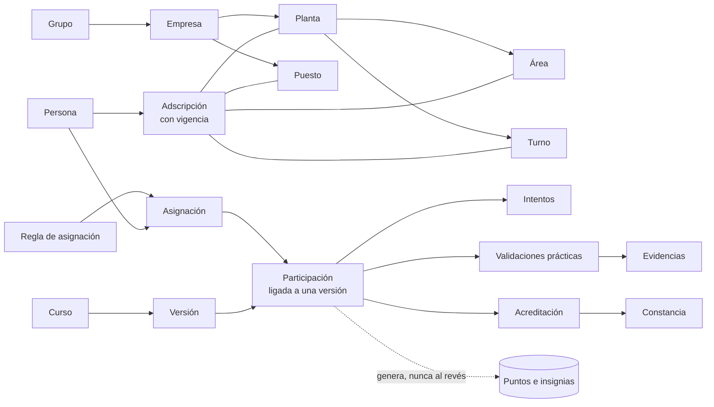

# 01 · Producto y alcance

Etiquetas: **[H]** hecho confirmado · **[R]** recomendación · **[S]** supuesto · **[P]** pendiente.

## 1. Objetivo del producto

**Objetivo.** Que cada persona reciba y acredite la capacitación que corresponde a su puesto, mediante una experiencia breve, clara y motivante, y que la empresa pueda demostrar con datos confiables:

- quién está capacitado y quién no;
- en qué curso y **en qué versión**;
- con qué evaluación, validación práctica y evidencia;
- desde cuándo y hasta cuándo es vigente.

**Dos experiencias, un mismo registro.**

| | Experiencia del trabajador | Administración |
|---|---|---|
| Propósito | Aprender y avanzar con motivación | Asignar, controlar, demostrar y exportar |
| Tono | Lúdico, directo, celebratorio sin infantilizar | Preciso, sobrio, orientado a datos |
| Dispositivo principal | Celular personal; tableta o computadora compartida | Computadora; tableta para validaciones en piso |
| Unidad de trabajo | La lección (de 3 a 5 minutos) [R] | El registro (persona, curso, versión, estado) |

### 1.1 Hechos confirmados

| # | Hecho [H] |
|---|---|
| H-01 | Plataforma web de capacitación gamificada para una empresa de manufactura, con progresión por niveles inspirada en Duolingo, sin copiar su identidad visual, personajes ni recursos. |
| H-02 | Población: operadores de producción, mantenimiento, supervisores, seguridad y contratistas. |
| H-03 | Primera implementación para una sola empresa. El modelo debe permitir separar empresas, plantas, áreas, turnos, puestos, personas y sus asignaciones. Las «empresas» son **razones sociales de un mismo grupo** (respuesta a B-4, 5 nov 2026). |
| H-04 | Volumen: unas 1,600 **personas distintas** al mes; convocatorias de unas 400 personas **inscritas** que avanzan a su ritmo, no de forma simultánea; plantilla total (HC) de 2,000 personas (respuesta a B-1, 5 nov 2026). |
| H-05 | Acceso desde celulares personales y desde computadoras o tabletas compartidas, con internet. |
| H-06 | El identificador de acceso es el número de empleado, pero no debe ser credencial suficiente. |
| H-07 | Los cursos se asignan según necesidad; no todas las personas toman todos los cursos. |
| H-08 | Temas posibles: manufactura, seguridad, calidad, procedimientos internos, Normas Oficiales Mexicanas. **No existe catálogo ni materiales.** |
| H-09 | Roles iniciales: Administrador, Recursos Humanos, Instructor, Supervisor, Auditor, Trabajador. |
| H-10 | Cada curso puede requerir evaluación digital, validación práctica o ambas. Los criterios aún no están definidos y deben ser configurables. |
| H-11 | Contenido generado por IA queda en borrador hasta revisión y aprobación humana. |
| H-12 | Exportaciones indispensables en PDF y Excel: reporte individual, matriz de capacitación, cumplimiento por unidad, historial de evaluaciones e intentos, evidencias y validaciones, constancias emitidas, pendiente y próxima a vencer. |
| H-13 | Constancias automáticas en PDF con datos registrados (no PDF con campos editables). Firmas y QR son opciones por confirmar. No se les atribuye validez oficial ni equivalencia con DC-3. |
| H-14 | Los puntos del juego no sustituyen la aprobación de una evaluación ni la validación práctica. |
| H-15 | Interfaz y entregables en español. |
| H-16 | Contratistas: la plataforma genera su identificador con prefijo y registra su empresa contratista (respuesta a B-2). |
| H-17 | Costo de mensajería cero: no se envían códigos por SMS, WhatsApp ni correo. La activación y la recuperación de acceso se resuelven en persona con el Administrador (respuesta a B-3). |

### 1.2 Lo que el producto **no** hará (para evitar expectativas ambiguas)

| # | No objetivo | Etiqueta |
|---|---|---|
| NO-01 | No sustituye al sistema de nómina ni al sistema de RH; recibe datos de personal y estructura, no los administra como fuente oficial. | [R] |
| NO-02 | No emite documentos oficiales ante autoridades. Las constancias son documentos internos generados con los datos registrados. No genera formatos DC-3 salvo decisión futura y validación jurídica. | [H] |
| NO-03 | No crea contenido normativo ni procedimientos por sí misma. La IA solo propone borradores a partir de documentos cargados. | [H] |
| NO-04 | Los puntos, insignias y rankings no se usan como criterio de evaluación del desempeño laboral. | [R] · confirmar con RH |
| NO-05 | No controla accesos físicos a planta ni contratos de contratistas. | [R] |
| NO-06 | La primera versión no funciona sin conexión; tolera conexiones intermitentes guardando el avance por actividad. | [R] |

## 2. Usuarios

### 2.1 Perfiles de la población (quiénes son)

El perfil describe a la persona; el **rol** (sección 2.2) describe lo que puede hacer en el sistema. Un supervisor, por ejemplo, también es trabajador cuando toma sus propios cursos.

| Perfil [H] | Contexto probable de uso [S] | Necesidades de diseño [R] |
|---|---|---|
| Operador de producción | Celular personal en pausas; tableta compartida en el área o en una sala. Tiempo limitado. Familiaridad digital variable. | Lecciones cortas, texto breve y legible, apoyo visual, botones grandes, avance guardado siempre, cero jerga técnica del sistema. |
| Personal de mantenimiento | Celular personal; consulta de pasos y riesgos. | Actividades de ordenamiento de pasos e identificación de riesgos con imágenes claras. |
| Supervisor | Computadora o tableta; celular en piso. Toma cursos y además da seguimiento a su equipo y valida prácticas. | Vista rápida de pendientes de su equipo; validación práctica en tableta con pocos toques. |
| Personal de seguridad | Computadora; posible instructor o validador de temas de seguridad. | Control de evidencias y vigencias; reportes por área. |
| Contratista | Dispositivo propio o compartido; estancias temporales. Identificador generado por la plataforma (por ejemplo, C-000123) y empresa contratista registrada [H]. | Acceso con vigencia limitada; asignaciones específicas por actividad o zona. |

### 2.2 Roles del sistema

| Rol [H] | Responsabilidad principal [R] | Alcance típico [R] |
|---|---|---|
| Administrador | Configura la empresa, la estructura, los roles, las plantillas y los parámetros. Genera las fichas de activación y restablece accesos [H]. | Empresa, o grupo completo si es corporativo |
| Recursos Humanos | Administra personas y movimientos, asignaciones, excepciones, constancias y reportes de cumplimiento. | Grupo, empresa o planta |
| Instructor | Crea y mantiene contenido; da seguimiento a resultados de sus cursos; valida prácticas si está autorizado. | Cursos asignados, dentro de una o varias plantas |
| Supervisor | Da seguimiento al avance de su equipo; valida prácticas si está autorizado. | Área y turno (uno o varios) |
| Auditor | Consulta en modo de solo lectura registros, evidencias, constancias, reportes y bitácora. | El alcance que se le asigne, hasta el grupo completo |
| Trabajador | Toma sus cursos, consulta su historial y descarga sus constancias. | Sus propios datos |

Ajustes propuestos al conjunto de roles:

- **[R] Roles acumulables y con alcance.** Una persona puede tener varios roles, cada uno limitado a una empresa, planta, área o turno. Ejemplo: «Supervisor del Área de Ensamble, Turno 2» y «Trabajador».
- **[R] «Aprobador de contenido» como permiso asignable, no como rol nuevo.** El requisito de que el contenido normativo sea revisado por una «persona responsable» exige saber, curso por curso, quién aprueba. Se propone un permiso que se otorga a personas concretas (normalmente Instructor o Seguridad) para cursos o temas concretos.
- **[R] «Validador práctico autorizado» por curso.** No todo supervisor o instructor debe poder validar cualquier práctica. La autorización se define en cada curso.
- **[R] Separar «Administrador de plataforma» de «Administrador de empresa».** El primero opera la plataforma técnica (varias empresas en el futuro) y, por defecto, no ve datos personales. El segundo es el rol «Administrador» del prompt, limitado a su empresa.

La matriz completa de permisos (consultar, crear, modificar, aprobar, exportar, por alcance) se entrega en la Etapa 2.

### 2.3 Alcance organizacional

[R] Todo permiso se evalúa como **rol + alcance**. El alcance es el grupo completo, o una empresa y, opcionalmente, planta, área y turno. Un usuario solo ve y exporta registros de personas cuya adscripción, en la fecha consultada, cae dentro de su alcance. Las reglas detalladas para reportes históricos están en [06-indicadores.md](06-indicadores.md#2-reglas-generales).

## 3. Contexto de uso

| Factor | Implicación de diseño |
|---|---|
| Celulares personales [H] | Diseño primero para pantalla pequeña. Sin instalación obligatoria; opcionalmente instalable como aplicación web [R]. Consumo de datos moderado: imágenes optimizadas [R]. |
| Dispositivos compartidos [H] | Sesión no persistente por defecto, cierre por inactividad, botón «Salir» siempre visible, sin datos residuales al salir. Detalle en [04](04-requisitos-no-funcionales.md#5-dispositivos-compartidos). |
| Internet disponible [H], calidad en piso desconocida [S] | Guardar avance en cada actividad; reintento automático de envíos; mensajes claros de «sin conexión». |
| Familiaridad digital variable [H] | Un objetivo por pantalla, lenguaje llano, iconos acompañados de texto, retroalimentación inmediata, activación asistida. |
| Entorno industrial [S] | Pausas cortas, posible ruido y uso de guantes: objetivos táctiles grandes (mínimo 44 × 44 px, preferible 48) [R], alto contraste, contenido que no dependa del audio. |
| Personas adultas [H] | Tono respetuoso. Gamificación basada en logro y dominio, no en presión. Sin mecánicas que castiguen el error con bloqueo. |
| Accesibilidad | Objetivo de diseño: WCAG 2.2 nivel AA [R]. Su cumplimiento se verificará en la Etapa 5; no se da por cumplido. |
| Idioma | Español [H]. Textos parametrizables para futuras variantes [R]. |

## 4. Alcance general

El alcance general incluye todo lo solicitado. El plan de versiones (sección 5) define **cuándo** se entrega cada parte; no elimina nada.

| Módulo | Contenido | Versión |
|---|---|---|
| M01 Identidad y acceso | Activación con ficha impresa, autenticación, recuperación asistida por el Administrador, sesiones, dispositivos compartidos, segundo factor para roles administrativos | V1 |
| M02 Estructura organizacional | Grupo, empresas (razones sociales), plantas, áreas (con subáreas), turnos, puestos; historial con fechas de vigencia | V1 |
| M03 Personas | Alta manual y carga masiva desde Excel, movimientos de puesto, área y planta sin perder historial, bajas, contratistas | V1 |
| M04 Roles y permisos | Roles acumulables con alcance; permisos de aprobador de contenido y validador práctico | V1 |
| M05 Autoría de contenido | Cursos, módulos, niveles, lecciones, actividades y bancos de preguntas; biblioteca de imágenes | V1 |
| M06 Flujo editorial y versiones | Borrador → revisión → publicado → archivado; versiones inmutables; fuentes y aprobación responsable | V1 |
| M07 Contenido asistido por IA | Carga de documentos, propuesta de contenido y preguntas en borrador, trazabilidad de lo generado | V2 (diseño en Etapa 2, simulación en Etapa 3) |
| M08 Asignaciones | Reglas por empresa, planta, área, turno, puesto y persona; excepciones; fechas límite; renovaciones | V1 |
| M09 Experiencia de aprendizaje | Panel personal, rutas por niveles, lecciones, actividades, retroalimentación, historial, constancias | V1 |
| M10 Motivación | Puntos, insignias, progreso, metas de equipo, ranking voluntario y modo privado; todo configurable | V1 (básico) · V2 (temporadas, retos) |
| M11 Evaluación y acreditación | Evaluaciones configurables, intentos, tiempos, prerrequisitos, validación práctica con evidencia, estados, vigencias | V1 |
| M12 Constancias | Plantillas, emisión automática, folio único, registro de emisiones, corrección, reemisión, revocación | V1 · QR y firmas por confirmar |
| M13 Indicadores y consultas | Tableros y consultas con fórmulas definidas | V1 (núcleo) · V2 (análisis de preguntas, competencias) |
| M14 Exportaciones | Las siete exportaciones indispensables en PDF y Excel, generadas en segundo plano | V1 |
| M15 Bitácora | Registro de cambios relevantes: quién, cuándo, qué cambió, sobre qué registro | V1 |
| M16 Notificaciones | Dentro de la app; notificaciones del navegador sin costo por mensaje. Sin SMS ni WhatsApp por decisión de costo cero | V1 (en la app) · V2 (navegador) |
| M17 Operación de plataforma | Configuración del grupo y sus empresas, respaldos, monitoreo, registro de errores | V1 (una empresa) · V2 (más empresas del grupo) |
| M18 Integraciones | Sincronización con sistema de RH, inicio de sesión corporativo (SSO), API | V2–V3, según sistemas existentes |

## 5. Plan de versiones

### V1 · Primera versión operativa (piloto controlado)

**Propósito.** Operar con datos reales en un alcance limitado (una empresa, una planta o algunas áreas, y de uno a tres cursos piloto [R]) para validar el recorrido completo: asignación → aprendizaje → evaluación → validación práctica → acreditación → constancia → reporte y exportación.

Incluye:

1. Estructura organizacional con modelo de grupo (aunque arranque con una empresa) y personas con carga desde Excel y validación de errores.
2. Activación de cuentas, inicio de sesión seguro, recuperación asistida y modo de dispositivo compartido.
3. Roles con alcance, incluido el Auditor de solo lectura.
4. Autoría manual con flujo editorial, versiones y registro de fuentes.
5. Cinco tipos de actividad: opción múltiple con imagen, ordenamiento de pasos, identificación de riesgos sobre imagen, caso de decisión y verdadero/falso.
6. Asignación por reglas y excepciones individuales.
7. Panel del trabajador, rutas por niveles, retroalimentación, puntos, insignias, ranking voluntario por equipo y modo privado.
8. Evaluación configurable y validación práctica con evidencia.
9. Acreditación automática, vigencias y renovación.
10. Constancias PDF automáticas con plantilla configurable y folio único; reemisión y revocación.
11. Indicadores núcleo y **las siete exportaciones indispensables en PDF y Excel**.
12. Bitácora de cambios, respaldos y monitoreo.

Fuera de V1: IA (sin documentos fuente todavía no aporta), integraciones e incorporación de más empresas del grupo. La mensajería con costo queda fuera del alcance (H-17).

**Criterio para pasar a V2 [R]:** el piloto completa al menos un ciclo real de asignación a constancia sin discrepancias entre los registros, los reportes y las constancias, y las personas pueden activar su cuenta y completar una lección sin ayuda en pruebas de usabilidad. Las metas numéricas se definen con la empresa [P].

### V2 · Escala dentro de la empresa

- Contenido asistido por IA (sujeto a la decisión B-6).
- Notificaciones del navegador, sin costo por mensaje.
- Verificación por QR y firmas en constancias, si no entran en V1.
- Sincronización con el sistema de RH e inicio de sesión corporativo, si existen.
- Incorporación de más empresas del grupo, reportes consolidados del grupo y transferencias de personal entre empresas con historial.
- Más tipos de actividad, retos de equipo y temporadas de ranking.
- Análisis de preguntas (dificultad, discriminación) y matriz de competencias.
- Tolerancia avanzada a falta de conexión.

### V3 · Multiempresa y analítica

- Configuración de nuevas empresas del grupo por autoservicio.
- Sesiones grupales con registro de asistencia, si llegan a necesitarse (B-1 indica que las convocatorias no son simultáneas).
- API para integraciones y herramientas de análisis.

## 6. Glosario y modelo conceptual

Estos términos se usarán igual en la interfaz, los reportes y el código.

| Término | Definición [R] |
|---|---|
| Grupo | Conjunto de empresas que comparten la plataforma, los catálogos que se decida compartir y los reportes consolidados. Es la unidad máxima de separación de datos. |
| Empresa | Razón social del grupo. Tiene sus propios números de empleado, configuración, plantilla de constancia y logotipo. |
| Planta | Centro de trabajo de una empresa. Tiene zona horaria propia. |
| Área | Unidad organizacional dentro de una planta. Admite subáreas. |
| Turno | Horario de trabajo definido por planta. No es jerárquico: atraviesa áreas. |
| Puesto | Función o posición definida por la empresa. |
| Persona | Individuo con un identificador interno inmutable dentro del grupo. El número de empleado es un atributo por empresa que puede cambiar o repetirse entre empresas. |
| Contratista · Empresa contratista | Persona externa con identificador generado por la plataforma (prefijo «C-») y el proveedor al que pertenece. La empresa contratista no es una empresa del grupo. |
| Adscripción | Combinación de planta, área, turno y puesto de una persona, con fecha de inicio y fin. Los movimientos crean una nueva adscripción; la anterior se conserva. |
| Curso | Contenido de capacitación con identidad estable a lo largo de sus versiones. |
| Versión de curso | Instantánea inmutable del contenido, la evaluación y los criterios de acreditación al publicarse. |
| Módulo · Nivel · Lección · Actividad | Jerarquía de contenido: un curso tiene módulos; un módulo, niveles; un nivel, lecciones; una lección, actividades. |
| Banco de preguntas | Conjunto de reactivos del que se toman las preguntas de práctica y de evaluación. |
| Regla de asignación | Indica qué curso deben tomar qué personas (por empresa, planta, área, turno, puesto o persona) y con qué fecha límite. |
| Asignación | Obligación vigente de una persona de acreditar un curso, generada por una regla o de forma manual. |
| Participación | Cada ciclo de trabajo de una persona en una versión de curso para cumplir una asignación. Una asignación puede tener varias participaciones a lo largo del tiempo (renovaciones, reinicios). **Es la unidad que se cuenta como «participación».** |
| Intento | Cada presentación de la evaluación digital dentro de una participación. |
| Validación práctica | Registro de un validador autorizado que confirma, con evidencia, la ejecución práctica. |
| Evidencia | Archivo o dato que respalda una validación o una acreditación (lista de verificación, foto, documento, firma). |
| Acreditación | Resultado de cumplir todos los criterios de una participación. Tiene fecha y, si aplica, vigencia. |
| Constancia | Documento PDF emitido a partir de una acreditación. Tiene folio único. |
| Puntos · Insignias | Mecanismos de motivación. **No forman parte del registro de capacitación.** |

