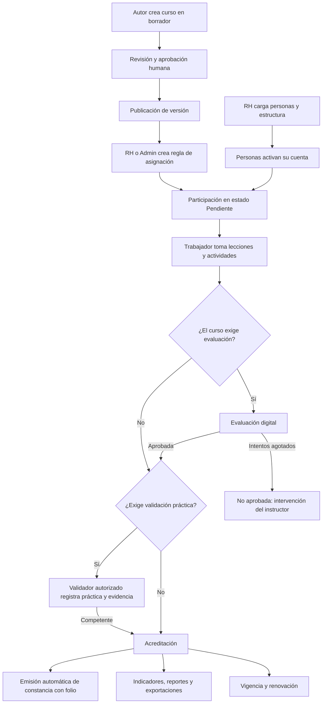

# 02 · Flujos principales

Etiquetas: **[H]** hecho confirmado · **[R]** recomendación · **[S]** supuesto · **[P]** pendiente.

Cada flujo indica actores, disparador, pasos, resultado y reglas. Las pantallas correspondientes se diseñarán en la Etapa 2.

## Recorrido completo (vista general)

## Índice

| ID | Flujo | Versión |
|---|---|---|
| F-01 | Configuración inicial de la empresa | V1 |
| F-02 | Carga de personas y estructura | V1 |
| F-03 | Activación de cuenta | V1 |
| F-04 | Inicio y cierre de sesión en dispositivo compartido | V1 |
| F-05 | Recuperación de acceso | V1 |
| F-06 | Creación manual de un curso | V1 |
| F-07 | Creación asistida por IA | V2 |
| F-08 | Asignación por reglas | V1 |
| F-09 | Excepción individual | V1 |
| F-10 | Recorrido de aprendizaje del trabajador | V1 |
| F-11 | Evaluación digital | V1 |
| F-12 | Validación práctica | V1 |
| F-13 | Acreditación y emisión de constancia | V1 |
| F-14 | Corrección, reemisión y revocación de constancia | V1 |
| F-15 | Vencimiento y renovación | V1 |
| F-16 | Movimiento de puesto, área o planta | V1 |
| F-17 | Consulta y exportación de reportes | V1 |
| F-18 | Auditoría | V1 |

---

### F-01 · Configuración inicial de la empresa

- **Actor:** Administrador.
- **Pasos:** registrar el grupo y la empresa (razón social) → plantas (con zona horaria) → áreas y subáreas → turnos por planta → catálogo de puestos → logotipo y datos para constancias → parámetros (gamificación activa o no, ranking, días de aviso de vencimiento, tiempo de inactividad en dispositivos compartidos).
- **Resultado:** empresa lista para cargar personas.
- **Reglas:** no se puede eliminar una unidad con historial; solo desactivarla con fecha [R].

### F-02 · Carga de personas y estructura

- **Actor:** Recursos Humanos.
- **Pasos:** descargar plantilla Excel → llenar número de empleado, nombre, tipo (empleado o contratista), planta, área, turno, puesto y fecha efectiva → subir archivo → el sistema valida (duplicados, unidades inexistentes, campos faltantes, formatos) → vista previa con altas, cambios y errores por fila → confirmar → registro en bitácora.
- **Resultado:** personas creadas o actualizadas en estado «Sin activar». Las reglas de asignación vigentes se aplican automáticamente.
- **Reglas:** para contratistas, la plataforma genera el identificador con prefijo (por ejemplo, C-000123) y se registra su empresa contratista [H]. La carga es todo o nada por archivo, o bien por filas válidas, a elección del usuario [R]. Un cambio de adscripción en la carga se trata como movimiento (F-16), no como sobrescritura. El número de empleado se guarda como texto para conservar ceros a la izquierda [R].

### F-03 · Activación de cuenta

- **Actores:** Administrador (genera las fichas); Administrador, RH o Supervisor (entregan la ficha); Trabajador.
- **Pasos:**
  1. El Administrador genera códigos de activación de un solo uso, de forma individual o por lote (por ejemplo, para toda una convocatoria). Se imprime una ficha por persona con el código, la empresa, la dirección de acceso y un QR que abre esa dirección con la empresa ya elegida [R].
  2. La ficha se entrega en persona. No se envían códigos por mensaje (costo cero, H-17).
  3. La persona abre la dirección, elige su empresa si el QR no la trae, y captura su número de empleado y el código.
  4. Crea su contraseña (frase de acceso) con ayuda visual de fortaleza.
  5. Lee y acepta el aviso de privacidad [P: texto a cargo de jurídico].
  6. Opcional: en su celular personal, puede activar el desbloqueo con huella o rostro (llave de acceso) [R]. No se piden correo ni celular.
  7. Elige si participa en el ranking. Por defecto: **progreso privado** [R].
- **Resultado:** cuenta activa; panel personal con sus cursos asignados.
- **Reglas:** el código caduca (propuesta: 72 horas, configurable) [R] y se invalida al usarse. Respuestas genéricas que no revelan si un número de empleado existe.

### F-04 · Inicio y cierre de sesión en dispositivo compartido

- **Actor:** Trabajador.
- **Pasos:** abrir la plataforma → número de empleado y contraseña → la sesión arranca en modo compartido (no se recuerda) → trabajar → «Salir» siempre visible, o cierre automático tras un periodo de inactividad con aviso previo de 30 segundos [R].
- **Resultado:** al salir no queda información de la persona en pantalla ni en el almacenamiento del navegador.
- **Reglas:** solo se ofrece «mantener sesión iniciada» si la persona indica que el dispositivo es personal. Los dispositivos registrados como compartidos nunca lo ofrecen. Las constancias se visualizan en el navegador; descargar exige confirmación con advertencia [R]. Detalle en [04](04-requisitos-no-funcionales.md#5-dispositivos-compartidos).

### F-05 · Recuperación de acceso

- **Actores:** Trabajador; Administrador.
- **Pasos:** la persona acude con el Administrador → verificación de identidad en persona (gafete o identificación) → el Administrador genera un código nuevo y lo entrega impreso o lo muestra en su pantalla → la persona repite F-03 desde el paso 3 → se cierran sus sesiones anteriores → la acción queda en bitácora con quién la autorizó.
- **Reglas:** no hay recuperación por autoservicio ni envío de mensajes (H-17). La pantalla de acceso indica claramente «¿Olvidaste tu contraseña? Acude con el administrador de tu planta». La recuperación nunca revela la contraseña anterior ni datos de la persona. La recuperación de un Administrador la hace otro Administrador.
- **Riesgo operativo:** en turnos sin Administrador presente, la persona no podrá entrar hasta el siguiente turno. Opciones: designar Administradores por planta y turno, o que el Administrador delegue el permiso «Restablecer acceso» a personas concretas. Decisión D-36.

### F-06 · Creación manual de un curso

- **Actores:** Instructor (autor), revisor y aprobador de contenido.
- **Pasos:**
  1. Crear curso en **borrador**: título, objetivo, público, duración estimada, tema y clasificación (interno, seguridad, calidad, normativo).
  2. Registrar **fuentes**: documento, versión o fecha, responsable. Obligatorio si la clasificación es normativa o de seguridad [H][R].
  3. Construir módulos, niveles, lecciones y actividades; cargar imágenes; crear el banco de preguntas.
  4. Configurar criterios de acreditación (ver [05](05-estados-y-acreditacion.md#4-parámetros-configurables-por-curso)).
  5. Vista previa como trabajador.
  6. Enviar a **revisión**. El revisor comenta, solicita cambios o aprueba.
  7. Si el curso es normativo o de seguridad, la aprobación final la da el **aprobador de contenido** designado para ese curso [H].
  8. **Publicar**: se crea una versión inmutable y numerada.
- **Resultado:** versión disponible para asignación.
- **Reglas:** no se publica un curso con criterios incompletos ni sin fuentes cuando son obligatorias. El autor no puede aprobar su propio contenido normativo [R]. El contenido de demostración lleva la marca «DEMO · CONTENIDO FICTICIO» y no puede asignarse a personas reales [R].

### F-07 · Creación asistida por IA (V2)

- **Actores:** Instructor; revisor; aprobador de contenido.
- **Pasos:** cargar documento → registrar la fuente (título, versión, fecha, propietario) → la IA propone estructura, lecciones, actividades y preguntas, cada elemento con referencia al fragmento del documento que lo sustenta → todo queda en **borrador** con la marca «Propuesto por IA · sin revisar» → el autor edita, acepta o descarta elemento por elemento → revisión y aprobación humana como en F-06 → publicación.
- **Reglas:** la IA no publica, no aprueba y no asigna. Un elemento sin referencia a la fuente no puede aprobarse en cursos normativos. El historial conserva qué fue propuesto por IA, qué cambió la persona y quién aprobó [R]. El envío de documentos internos a un servicio de IA depende de la decisión B-6.

### F-08 · Asignación por reglas

- **Actores:** Recursos Humanos o Administrador.
- **Pasos:** elegir curso → definir a quién (empresa, planta, área, turno, puesto, personas, o combinaciones) → tipo (obligatorio u opcional) → fecha límite absoluta o relativa (por ejemplo, 30 días a partir de la asignación o del ingreso) → **vista previa** con el número de personas afectadas y la lista → confirmar.
- **Resultado:** se crean las asignaciones y sus participaciones en estado «Pendiente»; las personas lo ven en su panel.
- **Reglas:** la regla es dinámica: quien entra después al alcance recibe la asignación con su fecha relativa; quien sale se trata según F-16. Si dos reglas asignan el mismo curso a la misma persona, existe **una sola asignación** con la fecha límite más próxima [R].

### F-09 · Excepción individual

- **Actores:** Recursos Humanos o Administrador (solicita y aprueba según configuración).
- **Tipos:** exentar a una persona de una asignación, asignar un curso adicional, extender la fecha límite, autorizar intentos adicionales.
- **Reglas:** toda excepción requiere motivo, persona que la aprueba y, en exenciones, fecha de vigencia. Queda en bitácora y aparece en los reportes como excepción, no como cumplimiento [R].

### F-10 · Recorrido de aprendizaje del trabajador

- **Actor:** Trabajador.
- **Pasos:** panel (pendientes ordenados por fecha límite) → abrir curso → ruta de niveles → lección de 3 a 5 minutos → actividades con retroalimentación inmediata que explica el porqué → puntos e insignias → siguiente lección. Al terminar el contenido obligatorio, se habilita la evaluación (si aplica).
- **Reglas:** el avance se guarda en cada actividad. Los errores en lecciones no bloquean el avance; las actividades falladas se repiten al final de la lección para reforzar [R]. Los puntos se otorgan por aprender, no por la evaluación [H][R].

### F-11 · Evaluación digital

- **Actor:** Trabajador.
- **Pasos:** pantalla previa con reglas claras (número de preguntas, tiempo, intentos restantes, calificación mínima) → iniciar intento (el servidor registra inicio y hora límite) → respuestas guardadas una por una → enviar → calificación calculada en el servidor → resultado con retroalimentación según configuración.
- **Si no aprueba y quedan intentos:** se sugiere repasar lecciones específicas; nuevo intento tras el tiempo de espera configurado.
- **Si se agotan los intentos:** estado «No aprobada»; aviso al instructor; solo una excepción (F-09) habilita intentos adicionales.
- **Reglas:** un intento enviado no se puede reenviar; un doble envío no crea un segundo intento [R]. Si vence el tiempo, el intento se cierra con las respuestas guardadas.

### F-12 · Validación práctica

- **Actor:** validador autorizado (Supervisor o Instructor autorizado para ese curso).
- **Pasos:** lista de personas pendientes de validación en su alcance → seleccionar persona → lista de verificación definida en la versión del curso → resultado por criterio y resultado general (Competente / Aún no competente) → observaciones → evidencia (foto o archivo, si se exige) → confirmación con su contraseña o segundo factor → opcional: la persona validada confirma en su propia sesión que la práctica ocurrió [R].
- **Resultado:** si es «Competente» y no faltan otros criterios, se acredita.
- **Reglas:** nadie puede validarse a sí mismo. La hora del registro la pone el servidor. Si la validación se registra después de realizada la práctica, se capturan ambas fechas.

### F-13 · Acreditación y emisión de constancia

- **Disparador:** se cumple el último criterio de acreditación.
- **Pasos:** el sistema registra la acreditación (fecha, versión, calificación si aplica, vigencia) → un proceso en segundo plano genera la constancia con la plantilla vigente y un folio único → se guarda el PDF con una huella digital de integridad → la persona la ve en su historial; RH y Auditor en reportes.
- **Reglas:** una acreditación tiene como máximo una constancia vigente. Si el proceso se repite por error, no se crea un duplicado [R].

### F-14 · Corrección, reemisión y revocación de constancia

- **Actor:** Recursos Humanos o Administrador.
- **Corrección de datos** (por ejemplo, nombre mal escrito): corregir el dato de la persona → reemitir → nueva constancia con nuevo folio, enlazada a la anterior, que pasa a estado «Sustituida».
- **Reemisión** (pérdida, cambio de plantilla): mismo flujo, con motivo.
- **Revocación** (acreditación otorgada por error o irregularidad): motivo obligatorio → la acreditación pasa a «Revocada» → la constancia pasa a «Revocada» → si se habilita la verificación por QR, la consulta muestra «Revocada».
- **Reglas:** nada se borra. Cada documento conserva su folio, su estado, su motivo y quién lo cambió.

### F-15 · Vencimiento y renovación

- **Disparador:** proceso diario por planta, según su zona horaria.
- **Pasos:** las acreditaciones dentro de la ventana de aviso se marcan «Por vencer» → si la asignación sigue vigente, se crea una participación de renovación → al pasar la fecha de vigencia sin renovar, la acreditación queda «Vencida».
- **Reglas:** la acreditación anterior sigue siendo válida hasta su fecha de vencimiento aunque exista una renovación en curso.

### F-16 · Movimiento de puesto, área o planta

- **Actor:** Recursos Humanos (manual o por carga masiva).
- **Pasos:** registrar la nueva adscripción con fecha efectiva → vista previa del impacto (asignaciones nuevas, asignaciones que dejan de aplicar) → confirmar.
- **Reglas:**
  - El historial de capacitación es de la **persona**, no del puesto: nunca se pierde.
  - Asignaciones que dejan de aplicar: si no se han iniciado, se cancelan con motivo «Cambio organizacional»; si están en curso, se aplica la configuración del curso: conservar como opcional (por defecto) o cancelar [R].
  - Acreditaciones vigentes que la nueva adscripción también exige se reconocen automáticamente.
  - Los reportes históricos atribuyen los registros según la regla definida en [06](06-indicadores.md#2-reglas-generales).
  - **Transferencia entre empresas del grupo (V2):** se registra la baja en la empresa de origen y el alta en la de destino, con su nuevo número de empleado. La persona conserva su identificador interno y todo su historial. Las acreditaciones de cursos compartidos por el grupo se reconocen.

### F-17 · Consulta y exportación de reportes

- **Actores:** cualquier rol con permiso de exportar, dentro de su alcance.
- **Pasos:** elegir reporte → aplicar filtros (periodo, unidad, curso, versión, estado) → vista previa → exportar a PDF o Excel → si el volumen es grande, se genera en segundo plano y se notifica en la app → descarga.
- **Reglas:** el archivo indica fecha y hora de generación, quién lo generó, alcance, periodo y filtros. El permiso se verifica al solicitar **y** al descargar. El enlace de descarga caduca [R]. Cada exportación queda en bitácora.

### F-18 · Auditoría

- **Actor:** Auditor.
- **Pasos:** consultar registros, versiones de curso, intentos, validaciones, evidencias, constancias y bitácora dentro de su alcance; exportar si tiene permiso.
- **Reglas:** solo lectura. Su propia actividad de consulta y exportación queda registrada.
