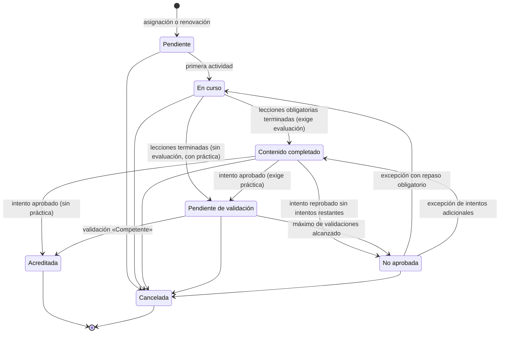

# 05 · Estados, reglas de transición y acreditación

Etiquetas: **[H]** hecho confirmado · **[R]** recomendación · **[S]** supuesto · **[P]** pendiente.

Propuesta preliminar para validar con la empresa. Se refinará en la Etapa 2. **No define criterios de acreditación de ningún curso**: solo el mecanismo con el que cada curso los configurará.

## 1. Por qué separar el estado en capas

Las palabras «completado», «aprobado» y «vencido» suelen usarse para cosas distintas y producen reportes ambiguos. Se proponen cuatro capas, cada una con una sola pregunta:

| Capa | Pregunta que responde | Quién la ve |
|---|---|---|
| **Participación** | ¿En qué punto del proceso va la persona? | Trabajador, instructor, supervisor |
| **Acreditación** | ¿La persona acreditó, y sigue vigente? | Todos los roles con alcance |
| **Constancia** | ¿El documento emitido es válido? | Trabajador, RH, Auditor |
| **Cumplimiento de la asignación** | ¿La persona cumple hoy con lo que se le exige? | Reportes e indicadores |

Equivalencias con los términos del requerimiento:

| Término usado | Significado preciso en el sistema |
|---|---|
| Curso iniciado | Participación **En curso** |
| Completado | Participación **Contenido completado**: terminó las lecciones obligatorias. **No implica aprobación.** |
| Aprobado | Resultado de un **intento de evaluación** que alcanzó la calificación mínima. Es un resultado de la evaluación, no del curso. |
| Pendiente de validación | Participación **Pendiente de validación práctica** |
| Acreditado | Se cumplieron **todos** los criterios del curso. Es el único estado que cuenta como capacitación cumplida. |
| Vencido | La **acreditación** superó su fecha de vigencia. Es distinto de **Atrasado**: la fecha límite pasó sin que la persona acreditara. |

## 2. Estados de cada capa

### 2.1 Participación

| Estado | Definición |
|---|---|
| Pendiente | Creada; sin actividad registrada. |
| En curso | Al menos una actividad registrada; faltan lecciones obligatorias. |
| Contenido completado | Lecciones obligatorias terminadas; falta aprobar la evaluación. |
| Pendiente de validación práctica | Criterios digitales cumplidos; falta la validación práctica. |
| No aprobada | Intentos de evaluación agotados, o máximo de validaciones prácticas alcanzado sin «Competente». Requiere intervención. |
| Acreditada | Todos los criterios cumplidos. Estado final de la participación; la vigencia se gestiona en la acreditación. |
| Cancelada | Cerrada sin acreditar, con motivo (asignación retirada, exención, nueva versión obligatoria, cambio organizacional). Estado final. |

Un curso sin evaluación ni validación práctica (solo lectura de contenido) pasaría de **En curso** a **Acreditada**. Si la empresa permite ese tipo de curso es una decisión pendiente [P].

### 2.2 Acreditación

| Estado | Definición |
|---|---|
| Vigente | Sin fecha de vencimiento, o con fecha de vencimiento futura. |
| Vencida | Pasó el final del día de vencimiento (hora de la planta). |
| Revocada | Anulada con motivo por un rol autorizado. Nunca vuelve a ser vigente. |

**Por vencer** no es un estado, sino una señal: acreditación vigente cuya fecha de vencimiento cae dentro de la ventana de aviso configurada.

### 2.3 Constancia

| Estado | Definición |
|---|---|
| Vigente | Emitida y válida. |
| Sustituida | Reemplazada por una reemisión (corrección o cambio de plantilla); enlazada a la nueva. |
| Revocada | Su acreditación fue revocada. |

Si la acreditación vence, la constancia **no cambia de estado**: sigue siendo un registro fiel de que la persona acreditó en esa fecha, con la vigencia impresa. La verificación por QR, si se adopta, mostraría «Acreditación vencida» [R].

### 2.4 Cumplimiento de la asignación (lo que muestran los reportes)

Se calcula para cada asignación no cancelada, en una fecha de corte, aplicando **la primera condición que se cumpla**, en este orden:

| Orden | Estado de cumplimiento | Condición |
|---|---|---|
| 1 | **Exenta** | Existe una exención vigente. |
| 2 | **Por vencer** | Existe una acreditación vigente que vence dentro de la ventana de aviso. |
| 3 | **Al día** | Existe una acreditación vigente. |
| 4 | **Vencida** | La última acreditación de esta asignación venció y no hay otra vigente. |
| 5 | **Atrasada** | Nunca tuvo acreditación vigente, o la perdió por revocación, y la fecha límite ya pasó. |
| 6 | **Pendiente** | Ninguna de las anteriores. Se muestra con el estado de su participación actual (por ejemplo, «Pendiente · En curso»). |

Este orden evita que una persona aparezca en dos categorías a la vez: cada asignación cae exactamente en una.

## 3. Reglas de transición

| ID | Regla | Etiqueta |
|---|---|---|
| RT-01 | **Versión.** La participación se liga a la versión publicada vigente al registrar su primera actividad, no al crearse. Quien todavía no empieza recibe la versión más reciente. | R |
| RT-02 | **Nueva versión menor.** No afecta a participaciones en curso ni a acreditaciones existentes. | R |
| RT-03 | **Nueva versión mayor con recapacitación.** Quien la publica decide, con vista previa de las personas afectadas: (a) cancelar las participaciones en curso y crear nuevas en la versión nueva; (b) crear un nuevo ciclo para quienes ya acreditaron, con fecha límite propia. Sus acreditaciones anteriores conservan su vigencia hasta que se cumpla esa fecha límite. | R |
| RT-04 | **Los puntos nunca provocan una transición.** Ningún estado depende de puntos, insignias ni rankings. | H |
| RT-05 | **Sin edición manual de estados.** Los estados se calculan en el servidor a partir de eventos registrados. Las intervenciones humanas solo ocurren mediante acciones tipificadas (intentos adicionales, exención, cancelación, revocación, registro externo), cada una con motivo, autor y bitácora. | R |
| RT-06 | **Después de aprobar no hay más intentos** en esa participación. La calificación que se reporta es la del intento aprobatorio. Todos los intentos quedan en el historial. | R |
| RT-07 | **Comparación exacta.** La calificación se compara con la mínima usando el valor sin redondear; el redondeo solo afecta la presentación. | R |
| RT-08 | **Tiempo límite.** Lo controla el servidor. Al vencer, el intento se cierra con las respuestas guardadas. Se admite un margen técnico breve para la latencia de red (propuesta: 30 segundos). | R |
| RT-09 | **Fecha de acreditación** = la fecha en que se cumplió el último criterio. Para la validación práctica se usa la fecha declarada de la práctica, que no puede ser futura ni anterior al límite configurado. | R |
| RT-10 | **Vencimiento** = fecha de acreditación + periodo de vigencia de la versión acreditada. La acreditación es válida hasta el final de ese día en la zona horaria de la planta. | R |
| RT-11 | **Renovación.** Si la asignación sigue activa, se crea una participación de renovación con la anticipación configurada. Su fecha límite es, por defecto, la fecha de vencimiento. La nueva vigencia corre desde la nueva acreditación (por defecto) o desde el vencimiento anterior (configurable). | R · P |
| RT-12 | **Prerrequisitos** se verifican al iniciar la participación. Si un prerrequisito vence durante el curso, la participación continúa. | R |
| RT-13 | **Exención.** La asignación pasa a «Exenta» y sus participaciones abiertas se cancelan. Se excluye del denominador de cumplimiento y se reporta aparte. Al terminar su vigencia, la asignación vuelve a estar activa con una nueva fecha límite. | R · P |
| RT-14 | **Registro externo** (capacitación previa a la plataforma). Crea una acreditación de tipo «Externa» con fecha, vigencia y referencia a evidencia. La plataforma no emite constancia por ella. Si cuenta para el cumplimiento lo decide RH. | P |
| RT-15 | **Revocación.** La acreditación y su constancia pasan a «Revocada». Se crea una nueva participación con la fecha límite que fije quien revoca. | R |
| RT-16 | **Acreditación reutilizable.** Si una persona recibe una asignación de un curso que ya tiene acreditado y vigente (por ejemplo, tras un movimiento), la asignación queda «Al día» de inmediato. | R |
| RT-17 | **Cancelación de un intento en curso.** Si la participación se cancela con un intento abierto, el intento se cierra como «Anulado» y no cuenta. | R |

## 4. Parámetros configurables por curso

Se configuran en cada versión. **Los parámetros marcados como «obligatorio» no tienen valor por defecto**: el autor debe capturarlos explícitamente, porque son criterios de acreditación que la empresa todavía no ha definido [H].

| Parámetro | Opciones | Valor inicial |
|---|---|---|
| Criterios requeridos | Contenido completado (siempre), evaluación digital, validación práctica | Obligatorio |
| Calificación mínima | 0 a 100 | Obligatorio si hay evaluación |
| Preguntas por intento y selección | Fijas, o aleatorias del banco por tema | Obligatorio si hay evaluación |
| Intentos máximos | 1 a N, o ilimitados | Obligatorio si hay evaluación |
| Espera entre intentos | Ninguna, horas o días | Ninguna [R] |
| Repaso obligatorio tras reprobar | Sí / No | No [R] |
| Tiempo límite por intento | Sin límite, o minutos | Sin límite [R] |
| Orden aleatorio de preguntas y opciones | Sí / No | Sí [R] |
| Retroalimentación al terminar la evaluación | Solo calificación · temas a repasar · respuestas correctas con explicación | Temas a repasar, sin revelar respuestas mientras queden intentos [R] |
| Examen de suficiencia (evaluar sin cursar las lecciones) | Sí / No | No [R] |
| Prerrequisitos | Lista de cursos | Ninguno |
| Vigencia | Sin vencimiento, o un periodo | Obligatorio |
| Ventana de aviso de vencimiento | Días | Definido por la empresa en su configuración general |
| Renovación | Automática o manual; anticipación; tipo (curso completo, solo evaluación o versión de repaso) | Obligatorio si hay vigencia |
| Base de la nueva vigencia | Desde la nueva acreditación · desde el vencimiento anterior | Desde la nueva acreditación [R] |
| Validación práctica: lista de verificación | Criterios observables, redactados por el autor y aprobados con el curso | Obligatorio si hay práctica |
| Validación práctica: validadores autorizados | Personas, o roles dentro de un alcance | Obligatorio si hay práctica |
| Validación práctica: evidencia mínima | Lista y confirmación · más foto · más documento | Lista y confirmación [R] |
| Validación práctica: máximo de validaciones | 1 a N, o ilimitadas | Ilimitadas [R] |
| Validación práctica: confirmación del trabajador | Sí / No | Sí [R] |
| Validación práctica: antigüedad máxima de la fecha declarada | Días | 7 [R] |
| Movimiento organizacional con participación en curso | Conservar como opcional · cancelar | Conservar como opcional [R] |
| Constancia | Emitir sí o no; plantilla | Emitir, con la plantilla de la empresa [R] |

## 5. Registro de la validación práctica

**Quién la autoriza.** El curso define a sus validadores autorizados; un Administrador o RH otorga esa autorización y queda en bitácora. Al registrar, el validador confirma con su contraseña o segundo factor; esa confirmación es la autorización del registro.

**Qué queda como evidencia:**

| Dato | Detalle |
|---|---|
| Participación | Persona, curso, versión y lista de verificación de esa versión |
| Validador | Persona, rol, autorización vigente al momento del registro |
| Fechas | Fecha declarada de la práctica y fecha y hora de registro (servidor) |
| Lugar | Planta y área; equipo o estación como texto opcional |
| Resultado | Por criterio (cumple / no cumple / no aplica) y general (Competente / Aún no competente) |
| Observaciones | Texto libre; obligatorio si el resultado es «Aún no competente» [R] |
| Archivos | Foto o documento, con huella de integridad, tipo, tamaño y quién lo subió |
| Confirmación del trabajador | Fecha y hora en que la persona confirmó desde su sesión, si se exige |

**Correcciones.** Una validación registrada no se edita. Si hubo un error, RH o un Administrador la anula con motivo y el validador registra una nueva. Ambas permanecen en el historial.

## 6. Ejemplos de aplicación

> **DEMO · CONTENIDO FICTICIO.** Cursos, valores y fechas inventados solo para ilustrar las reglas. No representan criterios de la empresa.

**Ejemplo 1 · Evaluación y práctica.** El curso ficticio «Uso de la prensa demo» exige evaluación (mínima ficticia de 80, 3 intentos) y validación práctica, con vigencia ficticia de 12 meses.

| Día | Evento | Participación | Cumplimiento |
|---|---|---|---|
| 1 | Asignación con fecha límite el día 30 | Pendiente | Pendiente |
| 2 | Primera lección | En curso | Pendiente · En curso |
| 4 | Termina las lecciones | Contenido completado | Pendiente · Contenido completado |
| 4 | Intento 1: 72 | Contenido completado | Pendiente |
| 5 | Intento 2: 86, aprobado | Pendiente de validación | Pendiente · Pendiente de validación |
| 12 | Validación «Competente», práctica declarada el día 11 | Acreditada (fecha: día 11) | Al día |
| 12 | Se emite la constancia con calificación 86 (intento aprobatorio) | — | Al día |

**Ejemplo 2 · Atrasada frente a vencida.** Ana nunca acreditó y su fecha límite pasó: **Atrasada**. Luis acreditó hace 13 meses con vigencia de 12 y no renovó: **Vencida**. Ninguno de los dos cumple, pero el reporte distingue ambas situaciones.

**Ejemplo 3 · Intentos agotados.** Tras 3 intentos sin aprobar, la participación queda **No aprobada** y la asignación aparece como «Pendiente · No aprobada» (o «Atrasada» si ya pasó la fecha límite). El instructor autoriza dos intentos adicionales con repaso obligatorio: la participación vuelve a **En curso** y la autorización queda en bitácora.
