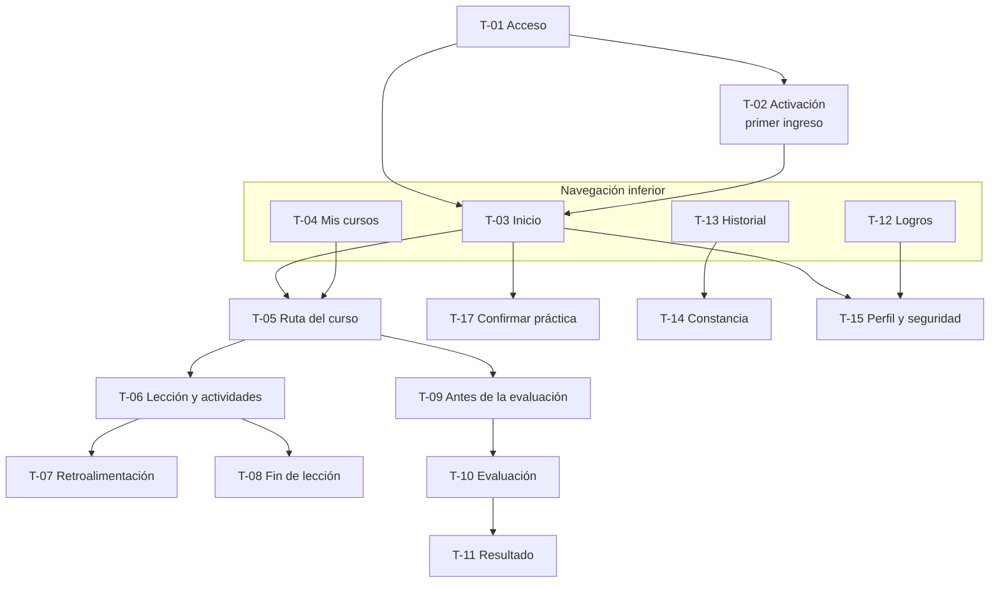
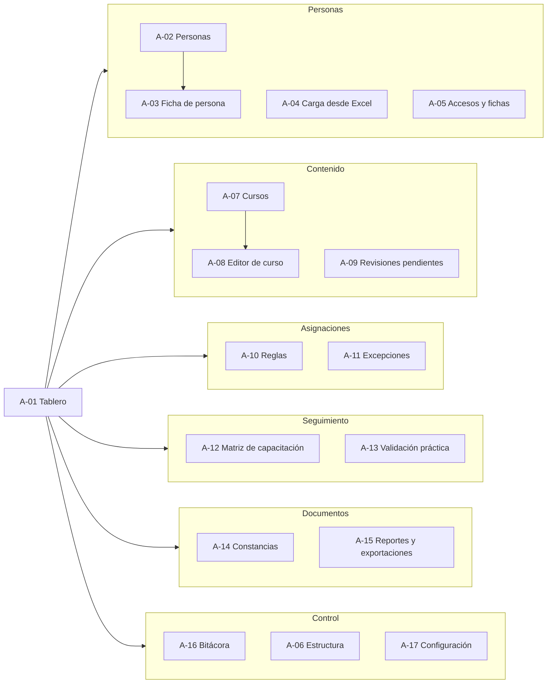

# 01 · Mapa de navegación

Etiquetas: **[H]** hecho confirmado · **[R]** recomendación · **[S]** supuesto · **[P]** pendiente.

## 1. Principios

1. **Dos espacios con una sola cuenta.** *Aprender* (experiencia lúdica, móvil primero) y *Administrar* (consola precisa, escritorio primero). Cada persona entra con la misma cuenta y solo ve los espacios y secciones que su rol y su alcance permiten [R].
2. **Quien tiene ambos espacios elige con un interruptor** en el encabezado: «Aprender · Administrar». Un supervisor toma sus cursos en *Aprender* y da seguimiento a su equipo en *Administrar*.
3. **El trabajador nunca ve la consola.** Si solo tiene el rol Trabajador, la aplicación no muestra el interruptor ni rutas administrativas.
4. **Profundidad máxima de tres toques** desde el inicio hasta cualquier lección pendiente o constancia propia [R].
5. **El alcance y la fecha de corte siempre visibles** en *Administrar*: toda cifra se lee dentro de un contexto explícito.

## 2. Espacio «Aprender» (trabajador)

Navegación inferior con cuatro destinos, siempre con ícono y texto. El encabezado muestra el nombre de la persona y el botón «Salir» en todas las pantallas.

| Destino | Contenido | Pantallas |
|---|---|---|
| **Inicio** | Lo que toca hoy: pendientes ordenados por urgencia, continuar donde se quedó, avisos (validación por confirmar, constancia nueva) | T-03, T-17 |
| **Mis cursos** | Cursos asignados con estado y avance; acceso a la ruta de cada uno | T-04, T-05 a T-11 |
| **Logros** | Puntos, insignias, ranking del equipo (si participa) y su preferencia de privacidad | T-12 |
| **Historial** | Cursos acreditados, vigencias, constancias | T-13, T-14 |
| Perfil (desde el encabezado) | Contraseña, llave de acceso, sesiones abiertas, privacidad, ayuda, salir | T-15 |

Pantallas transversales: T-16 aviso de inactividad y sesión cerrada; estados de error, vacío y sin conexión ([04 §4](04-pantallas.md#4-estados-transversales)).

## 3. Espacio «Administrar» (consola)

Menú lateral agrupado por tarea. En tableta y celular se pliega en un menú. El encabezado fija el **selector de alcance** (grupo, empresa, planta) y la **fecha de corte**.

| Grupo de menú | Secciones | Roles que lo ven (según [02](02-matriz-de-permisos.md)) |
|---|---|---|
| Tablero | Indicadores de cumplimiento del alcance | Administrador, RH, Instructor (sus cursos), Supervisor (su equipo), Auditor |
| Personas | Personas, ficha de persona, carga desde Excel, accesos y fichas | Administrador, RH; Supervisor e Instructor solo consultan; Auditor consulta |
| Contenido | Cursos, editor, bancos de preguntas, imágenes, revisiones pendientes | Instructor, Administrador; los demás consultan el catálogo publicado |
| Asignaciones | Reglas, matriz por puesto, excepciones | Administrador, RH; Supervisor solicita excepciones; Auditor consulta |
| Seguimiento | Matriz de capacitación, avance, evaluaciones, validación práctica, vencimientos | Todos los roles administrativos dentro de su alcance |
| Documentos | Constancias y plantillas, reportes y exportaciones | Administrador, RH, Auditor; Instructor y Supervisor dentro de su alcance |
| Control | Bitácora, estructura organizacional, configuración | Administrador; Auditor consulta la bitácora; RH consulta la estructura |

### Modo de validación en piso

Los validadores autorizados tienen un acceso directo **«Validar práctica»** que abre A-13 en formato de tableta, con botones grandes y sin el resto de la consola. Sirve para registrar validaciones junto a la estación de trabajo [R].

## 4. Páginas públicas

| Página | Contenido | Estado |
|---|---|---|
| Acceso | T-01 | V1 |
| Verificación de constancia por QR | Folio, estado (vigente, sustituida, revocada, acreditación vencida), curso, fecha. Sin número de empleado | Depende de D-22 |

## 5. Direcciones propuestas

| Dirección | Uso |
|---|---|
| `/{grupo}/acceso` | Pantalla de acceso del grupo (el QR de la ficha añade la empresa) |
| `/{grupo}/aprender/...` | Espacio del trabajador |
| `/{grupo}/admin/...` | Consola |
| `/verificar/{folio}` | Verificación pública, si se adopta |

Las direcciones son una propuesta reversible; se fijan en la Etapa 4.
