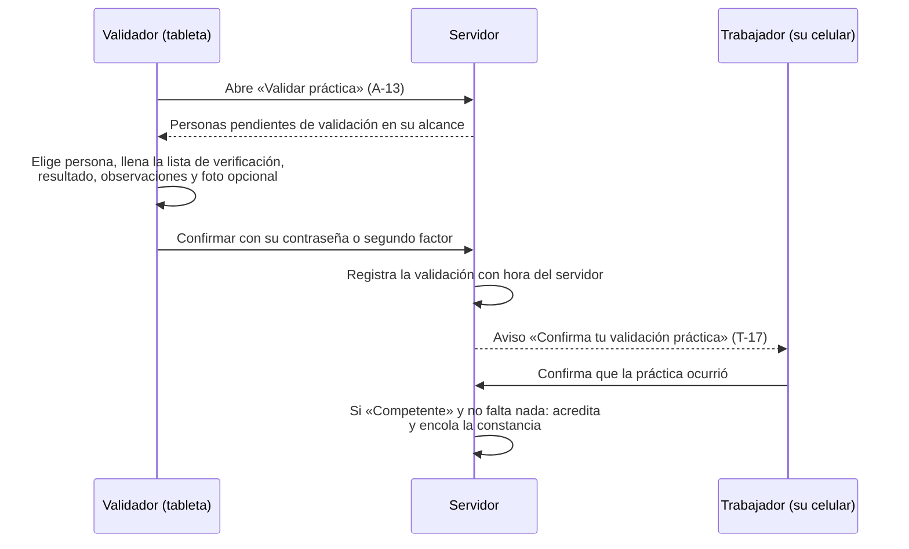

# 03 · Flujos detallados por pantalla

Etiquetas: **[H]** hecho confirmado · **[R]** recomendación · **[S]** supuesto · **[P]** pendiente.

Detalla, pantalla por pantalla, los flujos de [Etapa 1 · 02](../etapa-1/02-flujos-principales.md) que tienen más riesgo de uso o de datos. Los identificadores T-xx (trabajador) y A-xx (administración) remiten a [04-pantallas.md](04-pantallas.md).

## FD-01 · Activación de una convocatoria

Contexto: llega una convocatoria de unas 400 personas, muchas sin cuenta activa [H].

1. **A-05** · El Administrador filtra a las personas de la convocatoria que no han activado su cuenta y pulsa «Generar fichas». Elige la caducidad (propuesta: 72 horas) y el formato de impresión (una ficha por hoja o 8 por hoja para recortar).
2. El sistema genera un PDF de fichas en segundo plano. Cada ficha lleva nombre, número de empleado, empresa, código, caducidad, dirección y QR, más instrucciones de tres pasos con dibujos.
3. Las fichas se reparten en persona (Administrador, RH o supervisores).
4. **T-01** · La persona escanea el QR, que abre el acceso con la empresa ya elegida, y pulsa «Activar mi cuenta».
5. **T-02 · paso 1** · Número de empleado y código de la ficha.
6. **T-02 · paso 2** · Crea su frase de acceso, con indicador de fortaleza y opción de mostrar el texto.
7. **T-02 · paso 3** · Lee el aviso de privacidad y lo acepta; elige si participa en el ranking (privado por defecto).
8. **T-03** · Llega a su Inicio con los cursos de la convocatoria.

**Casos de error**

| Caso | Mensaje | Acción |
|---|---|---|
| Código vencido o ya usado | «Este código ya no es válido. Pide una ficha nueva a tu administrador.» | Volver al inicio |
| Número y código no coinciden | «Revisa tu número de empleado y el código de tu ficha.» (no revela cuál de los dos falla) | Reintentar, con demora progresiva |
| Frase de acceso débil o común | «Esta frase es fácil de adivinar. Prueba con tres o cuatro palabras que solo tú recuerdes.» | Corregir |
| Se pierde la conexión en el paso 2 | «Sin conexión. Tus datos no se han enviado.» | Reintentar; el código no se consume hasta que la activación termina |

**Recomendación operativa [R]:** realizar una jornada de activación asistida al abrir cada convocatoria, con el Administrador presente, para resolver en el momento los olvidos y errores (riesgo R-14).

## FD-02 · Acceso y salida en una tableta compartida

1. **T-01** · El equipo está registrado como compartido: no aparece «Mantener sesión iniciada». Una franja indica «Equipo compartido · Tu sesión se cerrará si dejas de usarlo».
2. La persona captura su número de empleado y su frase de acceso.
3. Durante la sesión, el encabezado muestra su nombre y el botón «Salir».
4. Tras 4 minutos y 30 segundos sin actividad (con el cierre configurado en 5 minutos), aparece **T-16**: «¿Sigues ahí? Tu sesión se cerrará en 30 segundos» con el botón grande «Seguir aprendiendo».
5. Si no responde, la sesión se cierra, se borran los datos locales y vuelve **T-01** con el aviso «Cerramos tu sesión para proteger tus datos. Tu avance quedó guardado».
6. Si estaba en una evaluación, el intento sigue abierto en el servidor y su reloj sigue corriendo (RT-08). Al volver a entrar, retoma el intento con sus respuestas guardadas si aún hay tiempo.

## FD-03 · Recuperación de acceso con el Administrador

1. **T-01** · «¿Olvidaste tu frase de acceso?» muestra: «Acude con el administrador de tu planta con tu gafete o identificación». No hay formulario de recuperación (B-3).
2. **A-03** · El Administrador busca a la persona, verifica su identidad en persona y pulsa «Restablecer acceso». Escribe el motivo y vuelve a autenticarse.
3. El sistema genera un código de un solo uso con caducidad corta (propuesta: 30 minutos) y lo muestra en pantalla con la opción de imprimirlo. Cierra todas las sesiones de la persona.
4. La persona sigue **T-02** desde el paso 1.
5. La bitácora registra quién restableció, a quién, cuándo y con qué motivo.

## FD-04 · Lección con actividades

1. **T-05** · La ruta muestra los niveles y lecciones; la siguiente lección disponible está resaltada con «Continuar».
2. **T-06** · Barra de avance de la lección arriba; una actividad por pantalla; botón «Comprobar» que se habilita al responder.
3. **T-07** · Al comprobar:
   - Correcto: franja verde, el porqué en una frase y «Continuar».
   - Incorrecto: franja roja con la respuesta correcta y la explicación; la actividad se agrega al final de la lección para repasarla.
4. **T-08** · Fin de lección: puntos obtenidos, aciertos, insignia si aplica y «Siguiente lección». Si es la última lección obligatoria, se ofrece la evaluación.
5. Cada respuesta se guarda en el servidor. Si se pierde la conexión, la respuesta queda en cola en el dispositivo y se reenvía; la persona ve «Guardando…» y después «Guardado».

## FD-05 · Evaluación digital

1. **T-09** · Antes de iniciar: número de preguntas, tiempo (si hay), intentos restantes, calificación mínima y qué pasa si no aprueba. Botón «Iniciar evaluación» con confirmación.
2. **T-10** · Una pregunta por pantalla, con navegación entre preguntas, reloj visible si aplica y marca «Guardado» en cada respuesta. Sin puntos ni animaciones de juego: la evaluación usa la apariencia sobria del espacio [R].
3. «Enviar evaluación» muestra un resumen de preguntas sin responder y pide confirmar. El envío es idempotente: tocar dos veces no crea dos intentos.
4. **T-11** · Resultado:
   - Aprobada y sin práctica: «Acreditaste el curso», fecha de vigencia y acceso a la constancia cuando esté lista.
   - Aprobada con práctica pendiente: «Aprobaste la evaluación. Falta tu validación práctica con un validador autorizado».
   - No aprobada con intentos: calificación, temas a repasar, intentos restantes y cuándo puede reintentar.
   - Intentos agotados: «Tu instructor revisará tu caso». Aviso automático al instructor.

## FD-06 · Validación práctica en piso

Reglas de pantalla:

- La lista de verificación se toma de la versión del curso que la persona cursó.
- Cada criterio se marca con botones grandes «Cumple», «No cumple» y «No aplica».
- Si algún criterio es «No cumple», el resultado sugerido es «Aún no competente» y las observaciones son obligatorias.
- La foto se comprime en el dispositivo antes de subirse. Si falla la subida, la validación no se confirma hasta subirla o quitarla.
- Si la persona no confirma en 7 días (configurable), la validación queda registrada con la marca «Sin confirmación del trabajador» y el supervisor recibe un aviso [R].

## FD-07 · Regla de asignación con vista previa

1. **A-10** · «Nueva regla» en tres pasos: **Qué** (curso y tipo: obligatorio u opcional) → **A quién** (empresa, plantas, áreas, turnos, puestos o personas, combinables) → **Cuándo** (fecha límite absoluta o relativa).
2. **Vista previa:** «Esta regla asignará el curso a **N** personas. **M** ya lo tienen acreditado y vigente y quedarán *Al día*. **K** son contratistas.» Lista descargable.
3. Confirmar con motivo opcional. Las asignaciones se crean en segundo plano; el resultado se muestra en la regla.

## FD-08 · Constancia: emisión, reemisión y revocación

1. Al acreditarse, se encola la emisión. **T-13** muestra «Generando tu constancia…» y luego el enlace.
2. **T-14** · El visor muestra el PDF en el navegador. En equipo compartido, «Descargar» advierte: «El archivo quedará guardado en este equipo».
3. **A-14** · Para reemitir: «Corregir y reemitir» o «Reemitir» con motivo; vista previa de la nueva constancia; confirmar. La anterior pasa a «Sustituida» con enlace a la nueva.
4. **A-14** · Para revocar: motivo obligatorio, reautenticación, confirmación que explica las consecuencias. La acreditación y la constancia quedan «Revocadas»; se crea una nueva participación con fecha límite.

## FD-09 · Exportación grande

1. **A-15** · Elegir reporte → filtros → formato. Encima del botón se muestra el resumen: «Alcance: Empresa Demo Norte · Periodo: 1–31 oct 2026 · 1,642 registros».
2. Hasta un umbral (propuesta: 5,000 filas), la exportación se descarga en el momento. Por encima, pasa a la cola: «Te avisaremos aquí cuando esté lista».
3. La cola muestra el estado (en espera, generando, lista, falló, caducada), la fecha de caducidad del enlace y un botón para repetirla.
4. Al descargar se vuelve a verificar el permiso.

## FD-10 · Alta de contratista

1. **A-02** · «Nueva persona» → tipo **Contratista**.
2. Captura nombre, empresa contratista (lista o nueva), empresa del grupo donde trabajará, planta, área, puesto o actividad y fecha de expiración del acceso.
3. El sistema genera el identificador (por ejemplo, **C-000123**) y ofrece imprimir su ficha de activación.
4. Las reglas de asignación para contratistas se aplican automáticamente.
5. Al llegar la fecha de expiración, la cuenta se desactiva; su historial se conserva.
