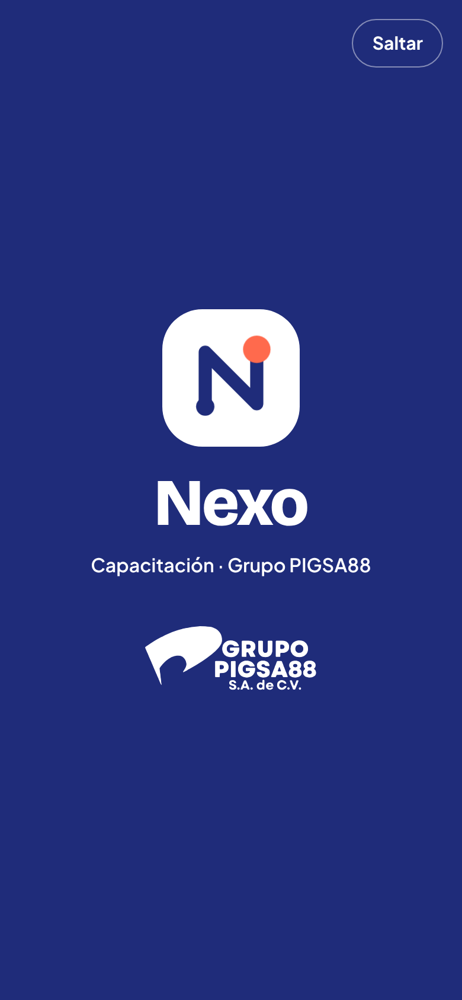

# 05 · Propuesta visual · versión 3 (Nexo · Grupo PIGSA88)

Etiquetas: **[H]** hecho confirmado · **[R]** recomendación · **[S]** supuesto · **[P]** pendiente.

> **Historial.**
> - **v1**, sobria e industrial. Reemplazada a petición de la empresa.
> - **v2**, minimalista, plana y juvenil, con paleta propia.
> - **v3**, versión actual (5 de noviembre de 2026). Conserva el estilo plano y juvenil de la v2, aplica la **identidad corporativa de Grupo PIGSA88** (logotipo y paleta entregados por la empresa) y adopta el nombre **Nexo** para la aplicación, también por decisión de la empresa [H].
>
> Las versiones anteriores siguen disponibles en el historial de git. Las pantallas de este documento son capturas del prototipo de la Etapa 3.

## 1. Marca

| Elemento | Decisión | Etiqueta |
|---|---|---|
| Nombre de la aplicación | **Nexo**. Sustituye al nombre de trabajo «Oficio». | H |
| Marca de la empresa | Logotipo de Grupo PIGSA88 S.A. de C.V. ([`docs/identidad/grupo-pigsa88.svg`](../identidad/grupo-pigsa88.svg)). Aparece en el acceso, la animación de entrada, el menú de administración, las constancias y los reportes PDF. | H |
| Símbolo de Nexo | Cuadrado redondeado azul corporativo con una «N» trazada como una línea que une dos puntos: un nodo blanco al inicio y un punto coral al final. Representa el vínculo entre la persona, su puesto y su capacitación. | R |
| Relación entre marcas | Nexo es la aplicación; Grupo PIGSA88 es la empresa. En la aplicación, Nexo encabeza y el logotipo corporativo acompaña. En los documentos oficiales internos (constancias y reportes), manda el logotipo corporativo. | R |
| Verificación de marca | Antes de usar «Nexo» fuera de la empresa, verificar que no haya conflicto de marca registrada | P |

## 2. Animación de entrada

Al abrir Nexo aparece una pantalla de entrada sobre azul corporativo:

1. El símbolo entra girando y crece (0 a 0.6 s).
2. La «N» se traza desde el nodo blanco hasta el punto coral, que aparece al final (0.4 a 1.35 s).
3. Suben el nombre «Nexo», el texto «Capacitación · Grupo PIGSA88» y el logotipo corporativo en blanco (1 a 1.9 s).
4. La pantalla se desvanece y queda el acceso (2.2 a 2.65 s).

| Regla | Detalle | Etiqueta |
|---|---|---|
| Duración | Menos de 3 segundos en total | R |
| Se puede saltar | Botón «Saltar», tocar en cualquier parte o la tecla Escape | R |
| Movimiento reducido | Si el dispositivo pide reducir el movimiento, no se muestra | R |
| Frecuencia | Solo al abrir la aplicación, no en cada cambio de pantalla | R |
| Rendimiento | Solo usa transformaciones y opacidad (sin imágenes pesadas). En equipos compartidos lentos debe probarse en la Etapa 5 | P |

## 3. Color

### 3.1 Paleta corporativa (entregada por la empresa)

| Color | HEX | Aplicación indicada | Cómo se usa en Nexo |
|---|---|---|---|
| Azul corporativo | `#1F2C7A` | Navegación, botones y acentos | Acción principal, tarjeta destacada, indicador principal, animación de entrada |
| Blanco | `#FFFFFF` | Fondos y texto sobre azul | Fondo de la aplicación, texto sobre azul |
| Gris claro | `#EEEEEE` | Superficies de apoyo | Tarjetas, paneles, campos y navegación inferior |
| Gris oscuro | `#313131` | Encabezados y texto principal | Texto principal y barra del prototipo |
| Gris medio | `#767676` | Párrafos y texto secundario | Bordes de campos y botones (ver 3.2) |
| Azul grisáceo | `#6A8695` | Información y detalles secundarios | Íconos, fichas de curso, estado «Pendiente de validación» (ver 3.2) |

### 3.2 Ajustes de accesibilidad (por aprobar)

Dos colores corporativos no alcanzan el contraste mínimo para texto pequeño (WCAG 2.x, 4.5 : 1) en todos los fondos. Se proponen variantes más oscuras **solo para texto**; el color original se conserva en todo lo demás [R · P].

| Color corporativo | Problema medido | Variante propuesta para texto | Resultado |
|---|---|---|---|
| Gris medio `#767676` | Sobre blanco cumple (4.54 : 1); sobre gris claro, no (3.91 : 1) | `#616161` | 6.19 : 1 sobre blanco y 5.34 : 1 sobre gris claro |
| Azul grisáceo `#6A8695` | No cumple ni sobre blanco (3.85 : 1) ni como fondo de texto blanco | `#4E6876` | 5.89 : 1 sobre blanco y 4.92 : 1 sobre su tono claro |

`#767676` sí cumple el mínimo de 3 : 1 para bordes de controles, que es donde se usa. `#6A8695` se usa en íconos y fichas, donde el mínimo también es de 3 : 1.

**Otro detalle por confirmar [P]:** el azul del logotipo (`#312783`) no es igual al azul corporativo de la tabla (`#1F2C7A`). Nexo respeta ambos: el logotipo conserva su color original y la interfaz usa `#1F2C7A`. Conviene que la empresa confirme cuál es el azul oficial.

### 3.3 Colores que no están en la paleta corporativa

| Color | Uso | Por qué | Etiqueta |
|---|---|---|---|
| Verde `#1A6B3C` / `#2E9E5B` | «Al día», respuesta correcta | Estados funcionales: siguen la convención de colores de seguridad y no deben depender de la marca | R |
| Ámbar `#8A5A00` / `#F2A900` | «Por vencer», precaución | Igual que el anterior | R |
| Rojo `#B42318` | «Vencida», «Atrasada», error | Igual que el anterior | R |
| Coral `#FF6A4D` | Puntos, insignias, punto del símbolo Nexo y decoración juvenil | La paleta corporativa no tiene un color cálido para celebrar logros; el coral da el tono juvenil pedido | R · P (aprobación de marca) |
| Azul brillante `#3B4CC0` | Ficha de curso | Tono derivado del azul corporativo para variar las fichas sin salir de la familia | R |

### 3.4 Tema oscuro

Fondo azul noche `#12152B` (derivado del azul corporativo), superficies `#1B2040`, texto `#F2F2F2` (16.06 : 1) y secundario `#B8BCCB` (9.50 : 1). La acción principal se aclara a `#9AA6F5` con texto oscuro encima (7.83 : 1). En este tema, el logotipo corporativo se muestra **en blanco**. Falta confirmar con la empresa que existe y se autoriza una versión en negativo del logotipo [P].

## 4. Tipografía

| Familia | Uso | Licencia |
|---|---|---|
| Bricolage Grotesque | Nombre «Nexo», títulos y cifras grandes | SIL Open Font License |
| Plus Jakarta Sans | Texto, botones y tablas (cifras tabulares) | SIL Open Font License |
| JetBrains Mono | Folios, números de empleado e identificadores «C-» | SIL Open Font License |

La empresa no indicó una tipografía corporativa. Si existe, se sustituye sin cambiar el diseño [P].

## 5. Estilo: plano, minimalista y juvenil

| Regla | Detalle |
|---|---|
| Sin sombras ni degradados | La jerarquía se marca con color sólido, tamaño y espacio |
| Superficies | Fondo blanco y bloques en gris claro corporativo |
| Radios generosos | 22 px en tarjetas, 16 px en opciones; botones y etiquetas en forma de píldora |
| Fichas de curso | Cuadrado de 48 px con color e ícono propios del curso |
| Decoración puntual | Círculo coral y cuadrado ámbar en la tarjeta principal; figuras de colores al terminar una lección |
| Ilustraciones | Escenas planas con formas simples, sin personajes ni mascota |
| Evaluación | Sin colores de juego, puntos ni animaciones |

## 6. Pantallas

### 6.1 Aprender (celular)

| | | |
|---|---|---|
|  **T-01** Acceso |  **T-03** Inicio |  **T-05** Ruta del curso |
|  **T-06** Elegir imagen |  **T-06** Identificar situaciones |  **T-07** Retroalimentación |
|  **T-08** Fin de lección |  **T-10** Evaluación |  **T-11** Resultado |
|  **T-12** Logros |  **T-13** Historial |  **T-16** Inactividad |

Tema oscuro: 

### 6.2 Administrar (computadora)

## 7. Tono y voz

Tuteo en *Aprender*, directo y cálido; trato impersonal en la consola (D-41). Celebraciones breves («¡Correcto!», «¡Nueva constancia!»), sin humor sobre los errores ni presión por entrar.

## 8. Accesibilidad

| Verificado | Cómo |
|---|---|
| Todos los pares de texto de la paleta aplicada cumplen al menos 4.5 : 1 en ambos temas, y los bordes de controles al menos 3 : 1 | Cálculo con la fórmula de luminancia relativa de WCAG 2.x (sección 3) |
| Ningún estado depende solo del color | Revisión de pantallas del prototipo |
| Objetivos táctiles de 44 px o más | Botones de 48 px, opciones de 58 px, navegación de 56 px |
| La animación de entrada se puede saltar y respeta la preferencia de movimiento reducido | Prueba automatizada y revisión de código |

**Pendiente:** lector de pantalla, teclado completo, zoom al 200 % y pruebas con personas reales.

## 9. Pendientes visuales

| ID | Pendiente |
|---|---|
| D-54 | Aprobar las variantes de texto `#616161` y `#4E6876` |
| D-55 | Confirmar el azul oficial (`#1F2C7A` frente a `#312783` del logotipo) |
| D-56 | Autorizar la versión en blanco del logotipo para fondos oscuros |
| D-57 | Aprobar el coral como acento de logros fuera de la paleta corporativa |
| D-41 | Tuteo o «usted» |
| D-49 | Validar el estilo juvenil con personas de distintas edades y perfiles |
