# 05 · Propuesta visual · versión 2 (minimalista, plana y juvenil)

Etiquetas: **[H]** hecho confirmado · **[R]** recomendación · **[S]** supuesto · **[P]** pendiente.

> **Historial.** La versión 1 (sobria e industrial) se reemplazó el 5 de noviembre de 2026 a petición de la empresa, que pidió un estilo **minimalista, plano (flat design) y juvenil** [H]. La versión 1 sigue disponible en el historial de git (commit `b848022`). Las pantallas de esta versión son capturas del prototipo de la Etapa 3, que pasa a ser la referencia visual.

Identidad propia: no usa la identidad visual, los personajes ni los recursos de Duolingo [H].

## 1. Concepto

**Plano, claro y con energía.** Superficies de color sólido, sin sombras, degradados, texturas ni bordes decorativos. La personalidad juvenil viene de tres recursos, siempre al servicio de la información:

1. **Una paleta saturada y alegre** (azul eléctrico, coral, sol, violeta y menta) sobre fondos muy claros.
2. **Formas geométricas grandes y redondeadas**: botones en forma de píldora, tarjetas de 22 px de radio, íconos de curso en «fichas» de color y figuras simples (un círculo y un cuadrado girado) como decoración puntual.
3. **Tipografía con carácter** en títulos y cifras grandes.

**Lo que no cambia de la versión 1:** la ruta del curso como **línea de proceso con estaciones** (recta, no serpenteante), las insignias como **placas hexagonales**, la separación entre juego y registro oficial, y la consola sobria y orientada a datos.

## 2. Dos registros, un mismo sistema

| | Aprender | Administrar |
|---|---|---|
| Objetivo | Motivar y guiar | Medir y demostrar |
| Color | Tarjeta principal en azul, fichas de curso de colores, logros en coral y sol | Un solo bloque de color (el indicador principal); el resto, superficies blancas y estados |
| Densidad | Una idea por pantalla | Tablas y paneles, sin decoración |
| Tipografía | Títulos grandes de 22 a 30 px | Títulos de 24 a 28 px; cifras grandes en los indicadores |
| Motivación | Puntos, insignias, ranking voluntario, celebración breve | Ninguna |
| Evaluación | Apariencia sobria: sin puntos, colores de juego ni animaciones | — |

## 3. Color

Paleta definida como variables de diseño, con versión clara y oscura (el prototipo sigue la preferencia del dispositivo).

### 3.1 Tema claro

| Variable | Valor | Uso | Contraste verificado |
|---|---|---|---|
| `--primary` | `#2F4BF0` | Acción principal, marca, tarjeta destacada | Texto blanco encima: 6.20 : 1 · sobre el fondo: 5.75 : 1 |
| `--primary-ink` / `--primary-soft` | `#2339C9` / `#E7EBFF` | Etiquetas y selección | 7.09 : 1 |
| `--coral` | `#FF6A4D` | Puntos, insignias y decoración | Texto tinta encima: 6.06 : 1 |
| `--coral-ink` | `#B83A1C` | Cifras de puntos | 5.74 : 1 sobre blanco |
| `--sun` | `#FFC53D` | Insignias, guía, prototipo | Texto tinta encima: 10.86 : 1 |
| `--violet` | `#6B4EFF` | Ficha de curso, pendiente de validación | Texto blanco encima: 5.05 : 1 |
| `--mint` | `#2BC37A` | Correcto, completado | Texto tinta encima: 7.50 : 1 |
| `--ink` | `#141A33` | Texto principal | 15.88 : 1 |
| `--ink-2` | `#535C77` | Texto secundario | 6.15 : 1 |
| `--bg` / `--surface` | `#F5F6FB` / `#FFFFFF` | Fondo y tarjetas | — |
| `--line-strong` | `#8B93AB` | Borde de campos | 3.06 : 1 (mínimo de 3 : 1 para componentes) |

### 3.2 Estados (siempre con color, ícono y texto)

| Estado de cumplimiento | Colores | Ícono | Contraste del texto |
|---|---|---|---|
| Al día | `#127547` sobre `#DCF4E7` | Palomita | 4.95 : 1 |
| Por vencer | `#835400` sobre `#FFF0C2` | Reloj | 5.72 : 1 |
| Vencida · Atrasada | `#BF2A2A` sobre `#FDE5E5` | Triángulo | 4.89 : 1 |
| Pendiente de validación | `#5537D6` sobre `#ECE8FF` | Personas | 6.05 : 1 |
| Pendiente · Exenta | `#535C77` sobre `#ECEFF7` | — | 5.77 : 1 |

Se mantiene la convención de colores de seguridad: verde para lo correcto, ámbar para la precaución y rojo para el error o el peligro. Seguridad debe validar la norma aplicable [P]. El violeta, que no es un color de seguridad, se usa para «esperando a otra persona».

### 3.3 Tema oscuro

Fondo `#0F1324`, superficies `#181D33`, texto `#EEF1FA` (16.33 : 1) y secundario `#A6AECA` (8.37 : 1). La acción principal se aclara a `#7F93FF` con texto oscuro encima (6.60 : 1). Todos los pares de estado superan 6.8 : 1.

## 4. Tipografía

| Familia | Uso | Por qué | Licencia |
|---|---|---|---|
| **Bricolage Grotesque** | Títulos y cifras grandes | Grotesca con personalidad juvenil, legible en tamaños grandes | SIL Open Font License |
| **Plus Jakarta Sans** | Texto, botones y tablas | Geométrica, moderna y clara en pantallas pequeñas; cifras tabulares en tablas | SIL Open Font License |
| **JetBrains Mono** | Folios, números de empleado e identificadores «C-» | Distingue 0 y O, 1 e l en datos que se copian o se dictan | SIL Open Font License |

Escala: texto de 15 a 17 px, enunciados de actividad de 22 px, títulos de 22 a 30 px y cifras de logros de 56 px.

Las tres familias son gratuitas, pero la legibilidad en planta (luz, distancia, pantallas pequeñas) debe confirmarse en las pruebas con usuarios [P]. Si alguna falla, la alternativa de mayor legibilidad es Atkinson Hyperlegible, propuesta en la versión 1.

## 5. Reglas de forma (flat)

| Regla | Detalle |
|---|---|
| Sin sombras ni degradados | La jerarquía se marca con color de fondo, tamaño y espacio |
| Bordes solo donde informan | Campos de captura, selección y estación actual |
| Radios generosos | 22 px en tarjetas, 16 px en opciones y paneles; píldoras en botones y etiquetas |
| Fichas de curso | Cuadrado de 48 px con el color y el ícono del curso; se repite en tarjetas, ruta e historial |
| Decoración puntual | Solo en la tarjeta principal de *Aprender*, en las celebraciones y en los estados vacíos |
| Ilustraciones | Escenas planas con formas simples y la misma paleta; sin personajes ni mascota |

## 6. Iconografía

Íconos de línea con trazo de 2.2 px y esquinas redondeadas, siempre con texto al lado. Los del prototipo se dibujaron para este proyecto. Para el desarrollo se recomienda una colección abierta con licencia permisiva (por ejemplo, Lucide, con licencia ISC), a confirmar en la Etapa 4 [R].

## 7. Motivación y movimiento

| Momento | Tratamiento |
|---|---|
| Respuesta correcta | Opción en verde, franja de retroalimentación y puntos |
| Respuesta incorrecta | Franja roja con la explicación; la actividad vuelve al final de la lección |
| Fin de lección | Círculo menta con figuras de colores alrededor, puntos en coral |
| Insignias | Placas hexagonales sólidas; las bloqueadas en gris con candado |
| Evaluación | Sin animaciones, sin puntos y sin colores de juego |
| Movimiento | Breve (menos de 1 s); desactivado si el dispositivo pide reducir movimiento |
| Sonido | Ninguno por defecto |

## 8. Maquetas

Las maquetas de esta versión son capturas del prototipo funcional, con datos ficticios.

### 8.1 Aprender (celular)

| | | |
|---|---|---|
| 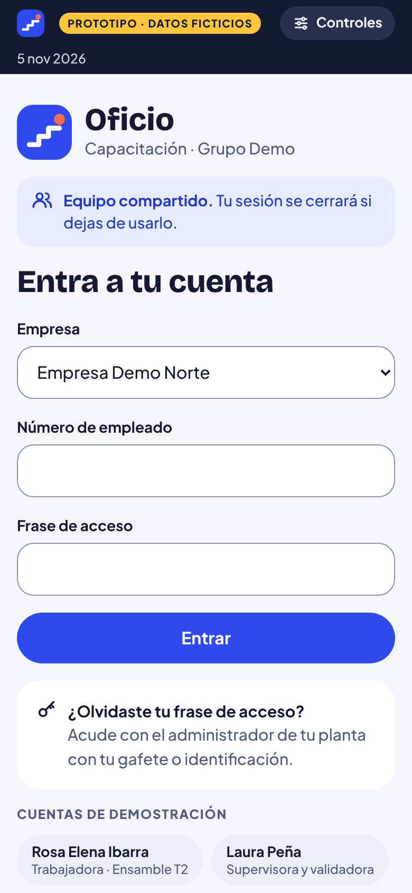 **T-01** Acceso | 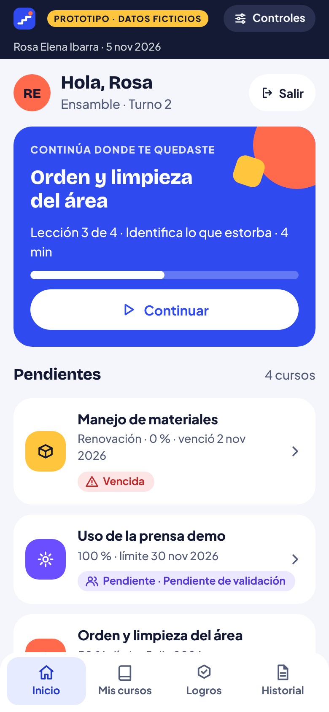 **T-03** Inicio | 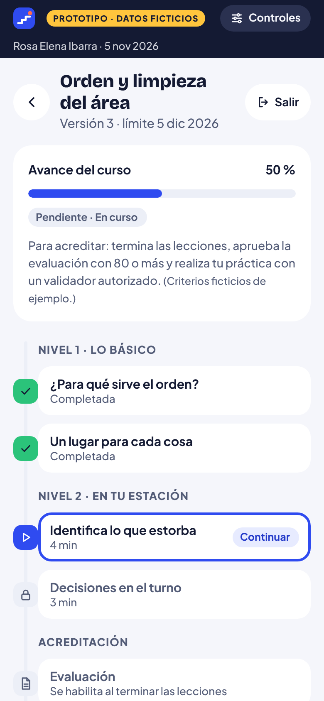 **T-05** Ruta del curso |
| 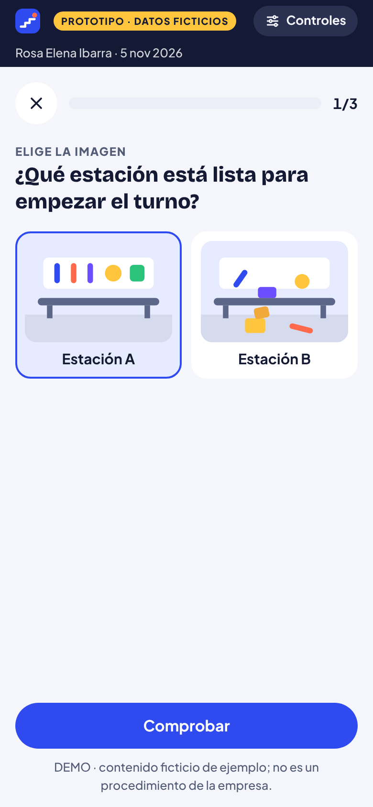 **T-06** Elegir imagen | 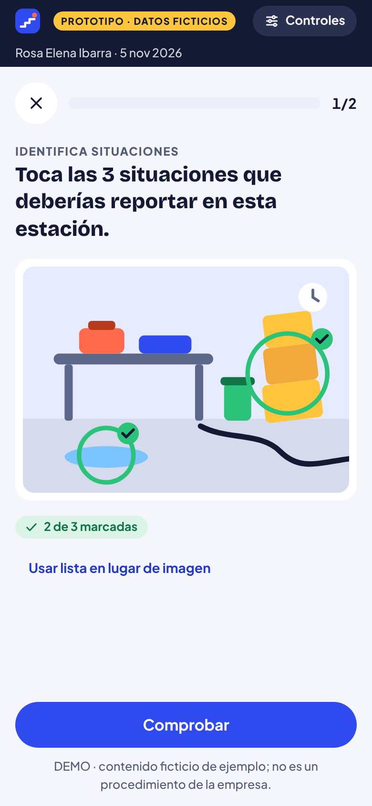 **T-06** Identificar situaciones | 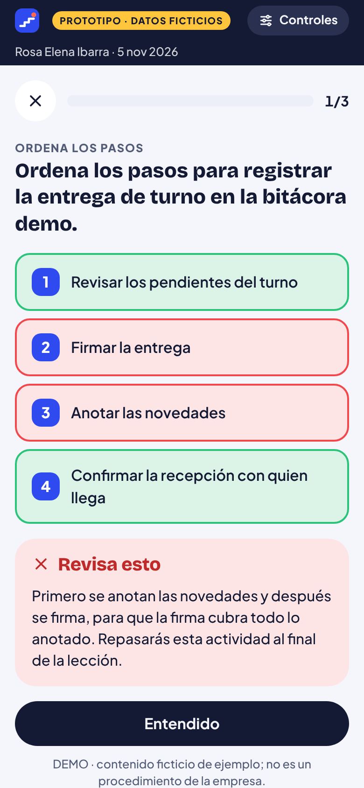 **T-07** Retroalimentación |
| 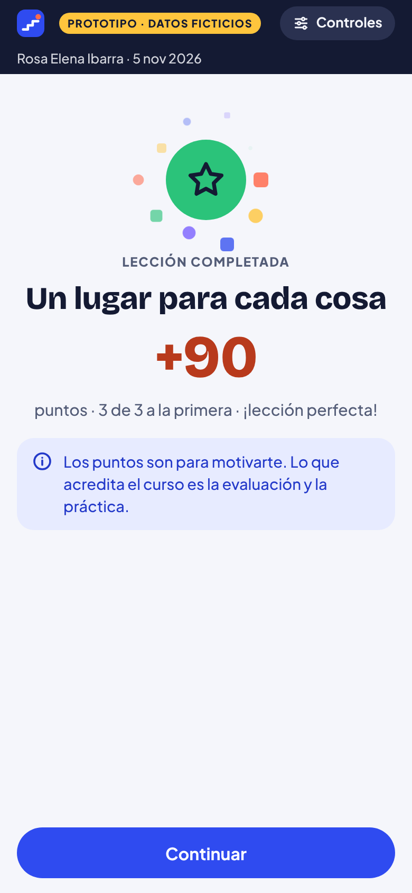 **T-08** Fin de lección | 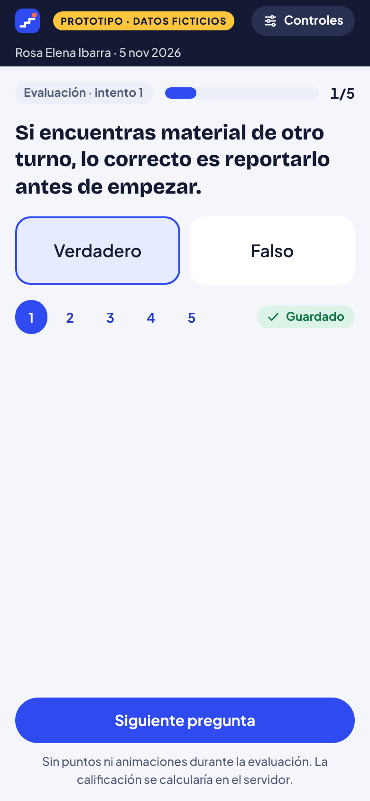 **T-10** Evaluación | 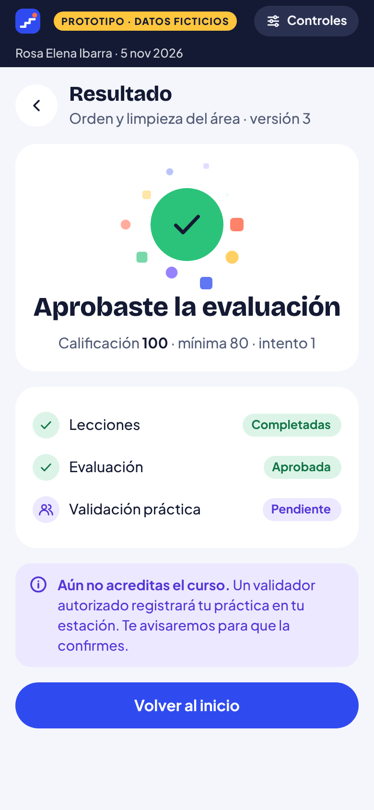 **T-11** Resultado |
| 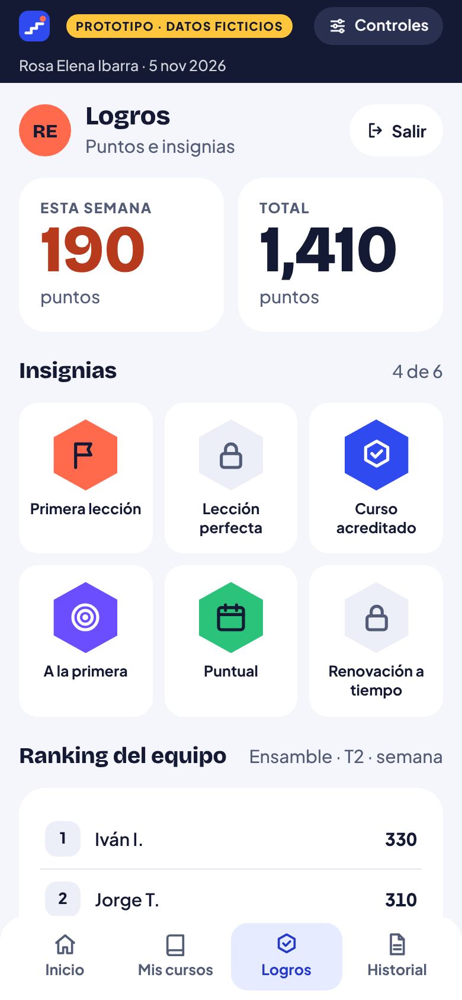 **T-12** Logros | 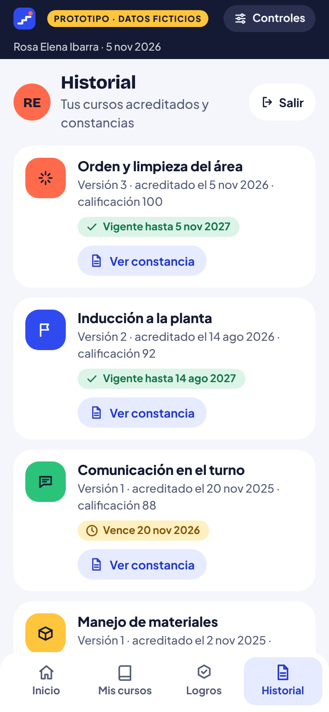 **T-13** Historial | 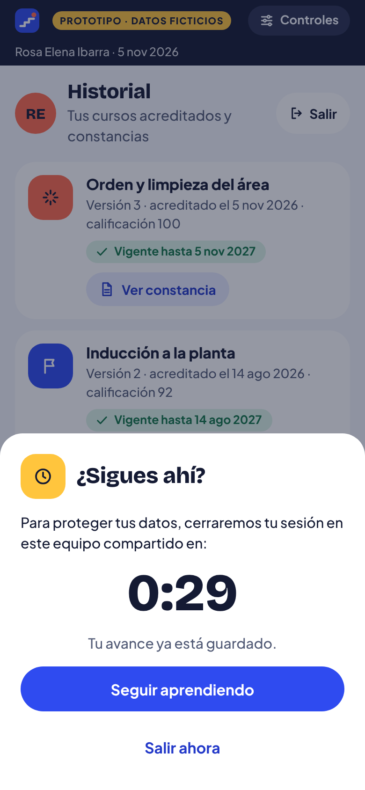 **T-16** Inactividad |

Tema oscuro: 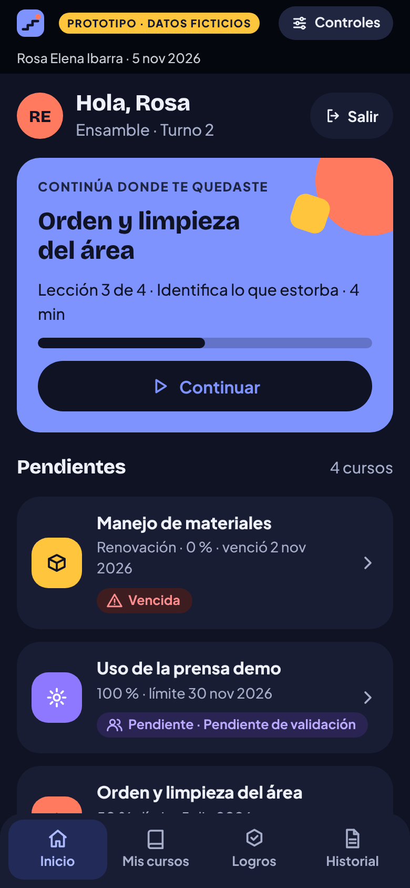

### 8.2 Administrar (computadora)

**A-01 · Tablero de cumplimiento**

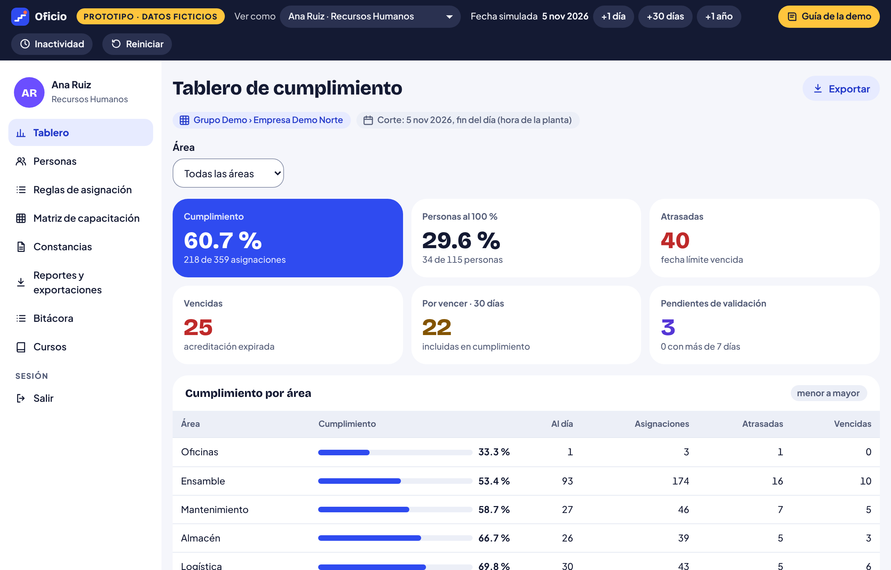

**A-12 · Matriz de capacitación**

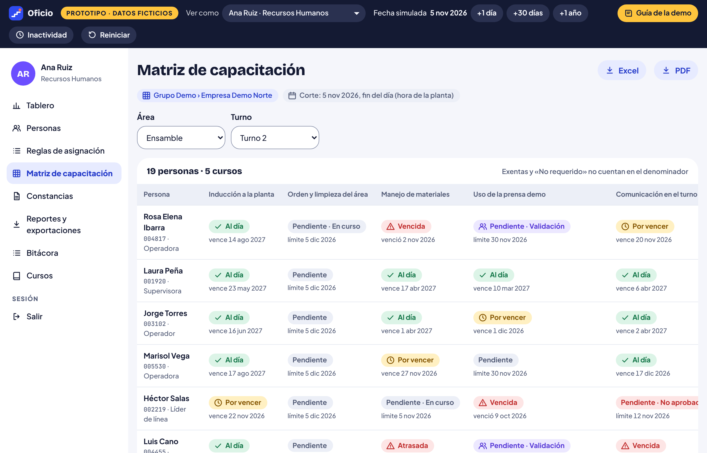

**A-10 · Regla de asignación con vista previa**

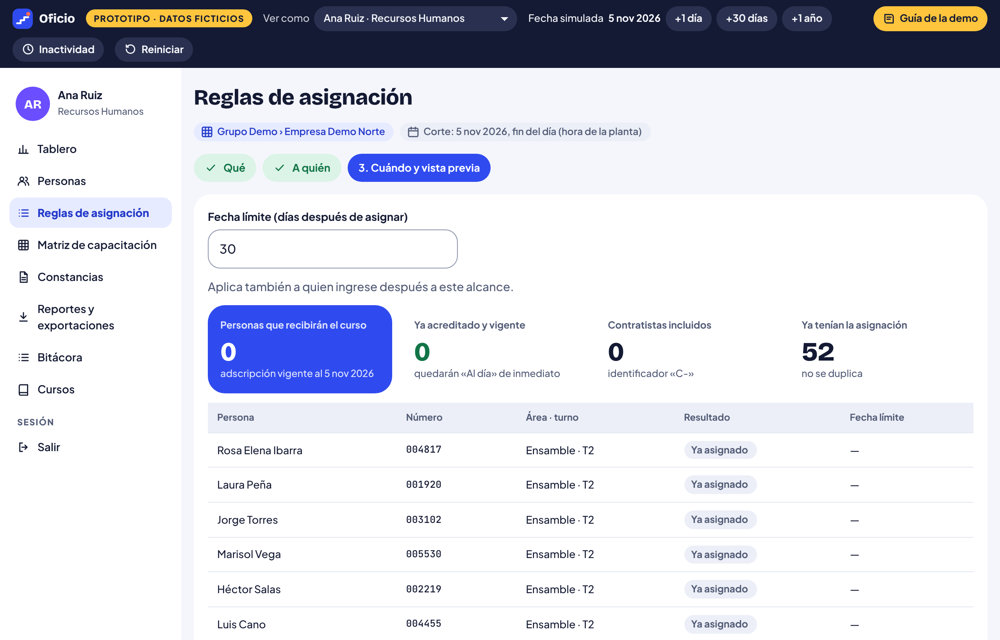

**A-13 · Validación práctica**

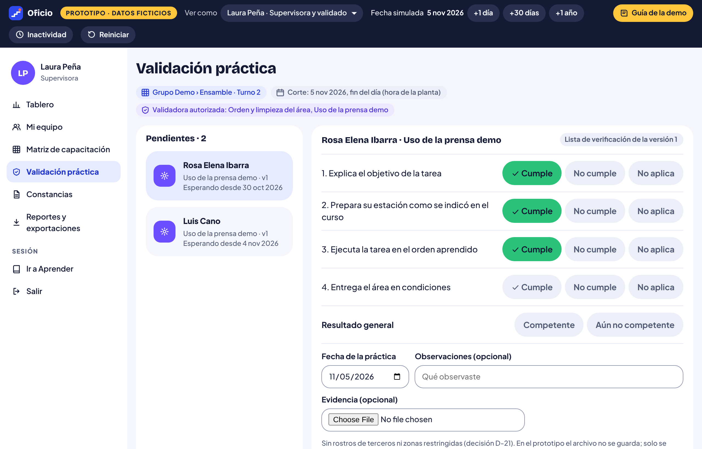

**A-14 · Constancia**

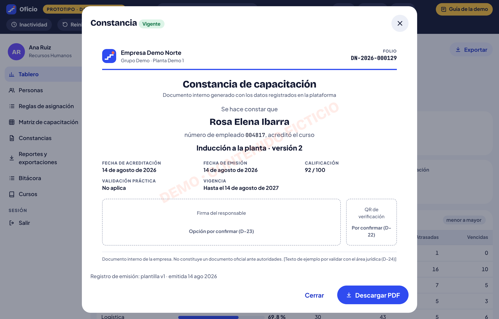

**Tablero en tema oscuro**

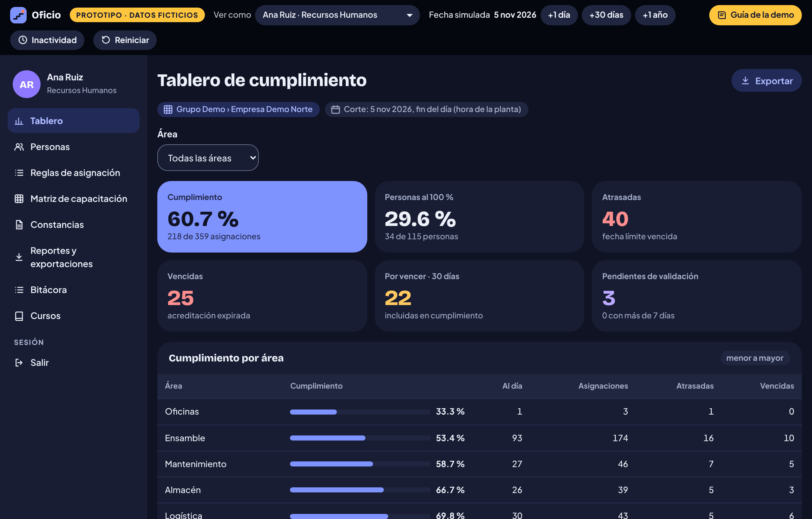

## 9. Tono y voz

Tuteo en *Aprender*, directo y cálido; trato impersonal en la consola (D-41). La versión juvenil permite frases más cortas y celebraciones («¡Correcto!», «¡Nueva constancia!»), pero nunca humor sobre los errores ni presión por entrar.

## 10. Accesibilidad

| Verificado | Cómo |
|---|---|
| Contraste de todos los pares de texto ≥ 4.5 : 1 en ambos temas y bordes de campos ≥ 3 : 1 | Cálculo con la fórmula de luminancia relativa de WCAG 2.x (sección 3) |
| Ningún estado depende solo del color | Revisión de pantallas del prototipo |
| Objetivos táctiles de 44 px o más | Botones de 48 px, opciones de 58 px, navegación de 56 px |
| Alternativa accesible a tocar sobre la imagen | Modo «Usar lista en lugar de imagen» |
| Movimiento reducido | Animaciones desactivadas con la preferencia del sistema |

**Pendiente:** pruebas con lector de pantalla y teclado completo, zoom al 200 % y pruebas con personas reales. El cumplimiento de WCAG 2.2 AA no se da por hecho [H].

## 11. Qué evitamos deliberadamente

- Mascota o personajes.
- Camino serpenteante de círculos: la ruta es una línea de proceso recta.
- Verde como color de marca: la marca es azul eléctrico y el verde queda para «correcto» y «al día».
- Botones con volumen o sombra inferior: los botones son píldoras planas.
- Vidas, corazones y rachas con presión diaria.
- Celebraciones dentro de la evaluación.

## 12. Pendientes visuales

| ID | Pendiente |
|---|---|
| D-40 | Nombre definitivo («Oficio» es de trabajo) y verificación de marca |
| D-41 | Tuteo o «usted» |
| D-42 | Si el tema oscuro se mantiene en V1 (el prototipo ya lo incluye) |
| D-49 | Validar la dirección visual juvenil con personas de distintas edades y perfiles en las pruebas de usabilidad |
