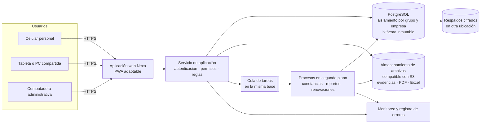

# 01 · Arquitectura propuesta

Etiquetas: **[H]** hecho confirmado · **[R]** recomendación · **[S]** supuesto · **[P]** pendiente.

> **Nada de lo que sigue está aprobado.** Es una recomendación para que TI y la dirección decidan. La infraestructura depende de la pregunta B-5, que sigue abierta. Por eso se recomienda una arquitectura **portátil**, que funcione igual en la nube o en servidores propios.

## 1. Requisitos que condicionan la arquitectura

| Requisito | Fuente | Consecuencia |
|---|---|---|
| 2,000 personas; unas 1,600 activas al mes; convocatorias de unas 400 | H (B-1) | Volumen moderado: una base de datos y pocas instancias de aplicación bastan. Objetivo de prueba: 400 sesiones simultáneas (D-35) |
| Varias empresas de un mismo grupo | H (B-4) | Aislamiento por grupo y empresa, con reportes consolidados para roles de grupo |
| Costo de mensajería cero | H (B-3) | Sin proveedor de SMS ni correo; avisos dentro de la app |
| Registro inmutable, versiones, bitácora, folios únicos | H | Base de datos transaccional con restricciones y controles en la propia base |
| PDF y Excel sin bloquear la aplicación | H | Procesos en segundo plano |
| Evidencias (fotos y documentos) | H | Almacenamiento de archivos separado de la base de datos |
| Celulares personales y equipos compartidos | H | Aplicación web adaptable; opcionalmente instalable (PWA) |
| Infraestructura sin definir | P (B-5) | Componentes estándar y portátiles; sin depender de servicios exclusivos de un proveedor |

## 2. Construir o adquirir

| Opción | A favor | En contra | Costo por validar |
|---|---|---|---|
| **A · Desarrollo a la medida (recomendada)** | Se ajusta exactamente al modelo definido: estados por versión, validación práctica, alcance por grupo, empresa, planta, área y turno, constancias y reportes en español. El prototipo ya prueba las reglas. Sin licencias por usuario | Requiere un equipo de desarrollo y mantenimiento continuo; la seguridad depende de que se construya y audite bien | Horas de desarrollo, revisión de seguridad independiente, operación mensual |
| B · Plataforma de aprendizaje de código abierto adaptada (por ejemplo, Moodle) | Producto maduro, sin licencia, con calificaciones, certificados y extensiones de gamificación | Adaptar el modelo de estados, la validación práctica con evidencias, el alcance organizacional y la experiencia juvenil exige desarrollo profundo sobre un sistema ajeno; las actualizaciones pueden romper las adaptaciones | Desarrollo de extensiones, alojamiento, mantenimiento de versiones |
| C · Plataforma comercial en la nube (SaaS) | Arranque rápido; el proveedor opera y actualiza | Pago por usuario y año; difícil cumplir exactamente las reglas de acreditación, el modelo multiempresa y las exportaciones definidas; los datos personales quedan en un tercero | Licencias anuales por 2,000 personas, contrato y revisión de privacidad |

**Recomendación [R]:** opción A. Los requisitos son específicos, el volumen es moderado y el prototipo ya validó el modelo. **Condición:** la empresa debe contar con un equipo responsable del desarrollo y la operación, interno o externo (pregunta B-7). Si no lo hay, la opción C se vuelve más realista aunque cumpla menos.

## 3. Componentes recomendados

| Capa | Recomendación [R] | Alternativas | Por qué |
|---|---|---|---|
| Aplicación web | Aplicación de una sola página en TypeScript, adaptable e instalable (PWA), con el sistema visual del prototipo | Páginas generadas en el servidor | Interacción fluida en lecciones y actividades; puede guardar respuestas en cola si falla la señal |
| Servicio de aplicación | TypeScript sobre Node.js (versión de soporte extendido) | Python (Django) o .NET | Mismo lenguaje en la web y en el servidor: las reglas de estados y cumplimiento del prototipo se reutilizan y se prueban una vez. Buen soporte de PDF, Excel, llaves de acceso y segundo factor. Si TI ya estandarizó .NET o Python, el diseño se traslada sin cambios de fondo |
| Base de datos | PostgreSQL 16 | SQL Server, si es el estándar de TI | Transacciones, restricciones y **seguridad por fila** para aislar grupos y empresas; disponible como servicio administrado en las nubes principales y gratuita en servidores propios |
| Archivos | Almacenamiento de objetos compatible con S3, con cifrado y enlaces temporales | Sistema de archivos en un servidor propio con respaldo | Evidencias y documentos fuera de la base, entregados solo con enlaces temporales después de verificar el permiso |
| Tareas en segundo plano | Cola sobre la misma PostgreSQL | Cola con un servidor adicional (por ejemplo, Redis) | A este volumen no hace falta otro servidor; la cola comparte las transacciones de la base, lo que ayuda a evitar duplicados |
| PDF | Plantillas HTML convertidas a PDF con un navegador sin interfaz en el proceso de fondo | Generación programática (como en el prototipo) | Plantillas de constancia fáciles de configurar y fieles al diseño |
| Excel | Librería de generación de libros con tipos de celda | — | Fechas, números e identificadores correctamente tipados, como ya se verificó en el prototipo |
| Autenticación | Módulo propio con librerías reconocidas: derivación Argon2id para frases de acceso, llaves de acceso (WebAuthn) y códigos de aplicación (TOTP) para el segundo factor | Proveedor de identidad (Keycloak propio o el corporativo de la empresa) | El flujo pedido (número de empleado, ficha impresa, recuperación con el administrador, equipos compartidos) es específico. El inicio de sesión corporativo (SSO) para personal administrativo se puede agregar en V2. **Requiere revisión de seguridad independiente** |
| Monitoreo | Registro de errores, métricas y alertas con estándares abiertos (OpenTelemetry) | Servicio comercial de monitoreo | Funciona igual en la nube o en servidores propios |
| Despliegue | Contenedores (Docker) con la misma imagen en pruebas y producción | Instalación directa en servidores | Portabilidad entre nube y servidores propios |

## 4. Opciones de hospedaje (depende de B-5)

> **Actualización del 5 nov 2026:** la empresa decidió hospedar todo en **Hostinger** (B-5). Eso corresponde a la opción 2. La propuesta concreta es un VPS con Docker Compose y está en [03 · Despliegue en Hostinger](03-despliegue-hostinger.md). La tabla siguiente se conserva como referencia.

| Opción | Descripción | A favor | En contra |
|---|---|---|---|
| 1 · Nube administrada | Contenedores administrados, PostgreSQL administrada, almacenamiento de objetos y respaldos del proveedor | Respaldos, parches y alta disponibilidad incluidos; menos carga para TI | Costo mensual; hay que definir la región de los datos (RNF-PRI-08) y el contrato |
| 2 · Nube con servidores virtuales | Docker en servidores virtuales que opera TI | Más control y posiblemente menor costo | TI asume parches, respaldos y monitoreo |
| 3 · Servidores propios | Docker en servidores de la empresa, con PostgreSQL y almacenamiento compatible con S3 instalados localmente | Datos dentro de la empresa | TI asume todo, incluido el acceso seguro desde celulares personales por internet |

**Recomendación preliminar [R]:** opción 1, si la política de TI lo permite. Los componentes son los mismos en las tres opciones, de modo que la decisión puede tomarse sin rehacer el desarrollo.

**Dimensionamiento inicial (estimado, a validar con la prueba de carga) [S]:**
- Dos instancias pequeñas de aplicación, para que una pueda fallar o actualizarse sin cortar el servicio.
- Una instancia de procesos de fondo.
- Una base de datos pequeña o mediana con respaldo continuo.

**Conceptos de costo a cotizar [P]:**
- Cómputo de aplicación y procesos.
- Base de datos administrada.
- Almacenamiento de archivos y respaldos.
- Transferencia de datos.
- Dominio y certificado.
- Monitoreo.
- Revisión de seguridad independiente.
- Horas de desarrollo y mantenimiento.

No se incluyen montos: dependen del proveedor y de los contratos de la empresa.

## 5. Seguridad por capas

| Capa | Control | Etiqueta |
|---|---|---|
| Red | Solo HTTPS; encabezados de seguridad; límite de solicitudes en acceso y recuperación | R |
| Aplicación | Sesión del lado del servidor; permisos por rol y alcance en cada solicitud; volver a autenticarse en acciones sensibles | R |
| Base de datos | La aplicación se conecta con un rol sin privilegios de dueño. La **seguridad por fila** impide leer o escribir datos de otro grupo o de empresas fuera del alcance, aunque la aplicación tenga un error. Bitácora con solo inserción | R · implementado en el núcleo de datos |
| Archivos | Enlaces temporales emitidos después de verificar el permiso; nunca públicos | R |
| Datos personales | Cifrado en tránsito y en reposo; minimización; sin datos personales en registros técnicos ni en servicios de IA | R |
| Verificación | Pruebas automáticas de aislamiento en cada entrega; revisión de seguridad independiente antes del piloto | R |

## 6. Qué decide cada pregunta pendiente

| Pregunta | Qué cambia |
|---|---|
| B-5 · Infraestructura | Opción de hospedaje, región de los datos, operación de respaldos y monitoreo. **No cambia** el código ni el modelo de datos |
| B-6 · IA | Solo el módulo de borradores asistidos (V2) |
| B-7 · Responsables | Quién desarrolla, opera y aprueba; condición de la recomendación de construir |
| Estándar tecnológico de TI, si existe | Lenguaje del servidor (TypeScript, .NET o Python) y base de datos (PostgreSQL o SQL Server) |
