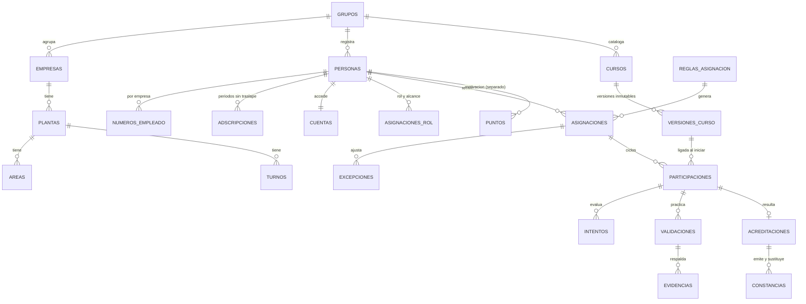

# 02 · Modelo de datos y núcleo de base de datos

Etiquetas: **[H]** hecho confirmado · **[R]** recomendación · **[S]** supuesto · **[P]** pendiente.

Implementación ejecutable en [`app/db/`](../../app/db/README.md) para PostgreSQL 16. Es una **propuesta pendiente de aprobación de TI** (D-33): si TI elige otro motor, el modelo se traslada, pero la seguridad por fila tendría que reimplementarse.

## 1. Principios

| Principio | Cómo se cumple |
|---|---|
| Separación por grupo y empresa | Toda tabla de negocio lleva `grupo_id`; las de una empresa, también `empresa_id`. Las llaves foráneas compuestas impiden ligar un registro a otro grupo |
| La base no confía en que la aplicación filtre bien | Seguridad por fila con fallo cerrado: si la aplicación no indica el usuario, no se ve nada |
| Nada se borra | La aplicación no tiene permiso de borrar en ninguna tabla. Cancelar, revocar o sustituir son cambios de estado con motivo |
| Historial sin huecos ni traslapes | Las adscripciones son periodos de vigencia que no pueden traslaparse |
| Lo emitido no cambia | Versiones publicadas, intentos enviados, validaciones, acreditaciones y constancias solo admiten los cambios de estado permitidos |
| Sin duplicados | Restricciones únicas: una asignación activa por persona y curso, un intento abierto, un número de intento, una constancia vigente por acreditación, folios únicos |
| Trazabilidad | Bitácora automática en 24 tablas, con valor anterior, valor nuevo, autor y motivo; solo inserción |
| Juego separado del registro oficial | Los puntos están en su propia tabla y ninguna regla de estado los consulta (D-01) |

## 2. Diagrama principal

## 3. Tablas

| Grupo | Tablas | Notas |
|---|---|---|
| Organización | `grupos`, `empresas`, `plantas`, `areas`, `turnos`, `puestos` | Las áreas admiten subáreas. Cada planta tiene su zona horaria. Los puestos pueden ser del grupo o de una empresa |
| Personas | `personas`, `numeros_empleado`, `adscripciones` | La identidad es del grupo. El número de empleado es por empresa, con vigencia; puede repetirse entre empresas (D-47) |
| Acceso | `cuentas`, `codigos_acceso`, `sesiones` | Solo se guardan derivaciones (hash) de frases y códigos. Restablecer exige motivo. Preferencia de ranking privada por defecto |
| Permisos | `asignaciones_rol` | Rol con alcance (grupo, empresa, planta, área y turno, cursos, propio) y vigencia. Nadie se otorga roles a sí mismo |
| Contenido | `cursos`, `versiones_curso` | Contenido, criterios y fuentes en JSON dentro de la versión. No se publica sin criterios obligatorios, ni contenido normativo o de seguridad sin fuentes y aprobador distinto del autor |
| Asignación | `reglas_asignacion`, `asignaciones`, `excepciones` | Toda excepción lleva motivo y aprobador; nadie se aprueba a sí mismo |
| Aprendizaje y evaluación | `participaciones`, `intentos`, `validaciones`, `evidencias` | La participación se liga a la versión al iniciar. Las evidencias guardan la ruta del archivo y su huella SHA-256, nunca un enlace público |
| Acreditación | `acreditaciones`, `contadores_folio`, `plantillas_constancia`, `constancias` | Folios por empresa y año, seguros ante solicitudes simultáneas. La constancia guarda los datos con que se generó |
| Motivación | `puntos` | Separada del registro oficial |
| Operación | `claves_idempotencia`, `exportaciones`, `bitacora` | Bitácora de solo inserción |

## 4. Cómo funciona el aislamiento

1. En cada transacción, la aplicación indica **solo quién es el usuario**: `SET LOCAL app.usuario_id = '…'`, tomado de la sesión autenticada.
2. La base calcula el grupo del usuario y sus empresas permitidas a partir de sus **roles vigentes**. Un rol con alcance de grupo (Administrador, RH o Auditor) ve todas las empresas del grupo.
3. Las políticas de seguridad por fila filtran lecturas y escrituras. Un trabajador ve sus propios registros.
4. Si no hay usuario en el contexto, no se ve ni se escribe nada.

**Capas:** la base garantiza el aislamiento por **grupo y empresa**. Los alcances más finos (planta, área y turno de un supervisor; cursos de un instructor) y los permisos por acción (quién crea, aprueba o exporta) los aplica el servicio de aplicación, según la [matriz de permisos](../etapa-2/02-matriz-de-permisos.md). Esas reglas se prueban en el módulo M2 ([`app/servicio`](../../app/servicio/README.md), 23 comprobaciones).

## 5. Verificación

`bash app/db/pruebas/ejecutar.sh` crea una base temporal, aplica las migraciones y ejecuta **50 comprobaciones**. Todas pasaron el 5 de noviembre de 2026 con PostgreSQL 16.

| Área | Comprobaciones |
|---|---|
| Aislamiento | Sin usuario no se ve nada. RH de grupo ve sus dos empresas y nada del otro grupo. RH de empresa ve solo su empresa y no puede escribir en otra ni en otro grupo. Actualizar fuera del alcance no afecta filas. La trabajadora ve solo lo suyo. Las llaves compuestas impiden mezclar grupos |
| Integridad | Asignación activa única; número de empleado único por empresa y repetible entre empresas; adscripciones sin traslape; cancelar exige motivo; sin borrado; nadie se otorga roles |
| Contenido | Versión publicada inmutable; no se publica con criterios incompletos; separación de funciones y fuentes obligatorias en seguridad y normativo; archivar sí se permite |
| Evaluación y práctica | Un intento abierto; intento enviado inmutable; número de intento único; aislamiento de intentos; observaciones obligatorias si aún no es competente; validación no editable; nadie se valida a sí mismo ni se aprueba excepciones |
| Acreditación y constancias | Folios consecutivos por empresa y año; no se generan folios fuera del alcance; una constancia vigente por acreditación; datos emitidos inmutables; reemisión enlazada; sin vuelta a vigente; revocar exige motivo; acreditación inmutable salvo revocación |
| Bitácora | Registra autor, valor anterior y nuevo, y motivo; la aplicación no puede escribirla ni modificarla; los eventos de exportación se registran; ni el dueño puede modificarla por la vía normal; no guarda frases ni códigos; aislada por grupo |

**Límites conocidos [R]:**
- Un superusuario de la base puede desactivar triggers. El acceso de superusuario debe restringirse al equipo de operación y registrarse fuera de la base.
- Al dar de alta una persona sin adscripción, la aplicación debe generar el identificador en lugar de pedirlo de vuelta a la base, porque esa persona todavía no es visible por alcance.
- El rendimiento de las políticas se medirá en la prueba de carga (Etapa 5).
